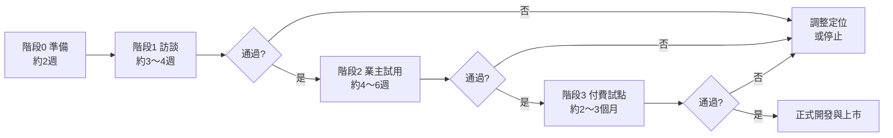

# 物業社區管理平台 SaaS 化 — 商業計畫書

| 項目 | 內容 |
|---|---|
| 文件版本 | v0.3（新增多年期預付與買斷（企業方案）評估） |
| 撰寫日期 | 2026-11-06 |
| 文件狀態 | 討論草案，價格與數字皆為**假設**，需經訪談與試用驗證 |
| 相關文件 | 原需求規劃書 v0.5（`../社區管理系統需求規劃書.md`）、SaaS 版需求規劃書（`社區管理系統SaaS版需求規劃書.md`） |

---

## 1. 摘要

- **做什麼**：把原本為單一物業公司規劃的「社區管理系統」，改成**多家物業公司共用、按月訂閱**的 SaaS 服務。
- **為誰做**：服務 5～60 個社區的**中小型物業管理／保全公司**。
- **差異化**：**「年長總幹事也用得來」**。前台以 LINE 為入口、3 步內完成作業；總公司端提供預警、稽核、管委會月報一鍵產出，以及「各社區使用率」監控。
- **怎麼賺錢**：以**公司為單位**訂閱，依「服務社區數級距 × 功能版本」收月費，另收一次性導入費。
- **現在要做的事**：**先驗證、後開發**。用現有需求書與雛型做 5～10 場訪談，再請業主找 1～2 位總幹事試用極簡 LINE 版本，通過後才進入正式開發。

---

## 2. 緣起

### 2.1 原案經過

| 時間 | 事件 |
|---|---|
| 2026-11 | 為業主（物業公司）完成需求規劃書 v0.5 與前後台畫面雛型 |
| 2026-11-05 | 業主評估後決定**不導入** |
| 同日 | 提出 SaaS 化構想，業主有興趣，願意透過人脈協助推廣 |

### 2.2 業主不導入的原因與啟示

> 業主：「公司內的總幹事年紀都較大，導入後學習曲線高，可能使用率偏低而浪費。」

| 觀察 | 啟示 |
|---|---|
| 業主**沒有否定需求**，只擔心「用不起來」 | 痛點存在，阻礙在**導入門檻**，不在功能 |
| 總幹事年長是**業界普遍現象** | 其他物業公司大多會有同樣顧慮；能解決這點就是**主要差異化** |
| 「浪費」代表怕**一次投入大、回收不確定** | SaaS 月繳、可退訂、先試用，正好降低這個顧慮 |
| 原需求書功能完整，但前台作業項目多 | SaaS 版要**分版本、可按社區開關模組**，讓客戶從少量功能開始 |

---

## 3. 市場與目標客群

### 3.1 目標客群

| 區隔 | 規模 | 是否為目標 | 理由 |
|---|---|---|---|
| 大型保全／物業集團 | 100+ 社區 | ✗ | 多半有自建系統或長期配合的資訊廠商，決策週期長 |
| **中型物業公司** | 20～60 社區 | ✓ 主力 | 已感受到「總公司管不到現場」的痛點，又沒有自建系統的資源 |
| **小型物業公司** | 5～20 社區 | ✓ | 老闆兼督導，最需要省人力；價格敏感 |
| 個體／單一社區 | 1～4 社區 | △ | 量小、流失率高，提供入門方案即可，不主動經營 |

> **待驗證**：台灣中小型物業公司的實際家數與社區數分布，需在訪談與公開登記資料中確認。

### 3.2 買家與使用者不同

| 角色 | 在意什麼 | 我們要給他什麼 |
|---|---|---|
| **老闆／總經理**（付錢的人） | 掌握各社區狀況、合約不漏續、毛利 | 儀表板、到期預警、社區損益 |
| **督導／區域主管** | 巡點、稽核、人力調度 | 稽核表單、改善單追蹤、人力缺口預警 |
| **總幹事**（用的人，常是年長者） | 不要增加工作、不要學新東西 | LINE 操作、拍照取代打字、管委會月報自動產出（**幫他省事**） |
| **保全／清潔**（常有外籍人員） | 簡單、看得懂 | LINE 圖文選單、多語系 |

**關鍵**：老闆買單的理由是「看得到現場」，但能不能看到，取決於總幹事願不願意用。所以產品設計要讓**總幹事覺得系統在幫他省事**，而不是多一份工作。

### 3.3 產業特性（影響導入策略）

- **公司常分屬不同法人**：依法規，保全業務與公寓大廈管理維護業務常由**不同公司**經營，同一集團底下可能有保全公司與物業公司兩個法人。SaaS 需支援「一個租戶多個法人」。
- **溝通以 LINE 為主**：現場與總公司的溝通大多在 LINE 群組，這是我們前台採 LINE 入口的理由。
- **外籍員工多**：保全、清潔常有外籍人員，多語系（繁中、英、印尼、越南、泰文）是實用的差異點。
- **毛利薄、價格敏感**：訂閱費需讓老闆算得出「省下的人力或避免的損失」大於費用。

---

## 4. 產品定位與差異化

### 4.1 一句話定位

> **給中小型物業公司的營運平台：總公司看得到每個社區，年長總幹事也用得來。**

### 4.2 與市面產品的差異

| 面向 | 市面常見社區系統 | 本平台 |
|---|---|---|
| 服務對象 | 多以**住戶**為主（住戶 App、包裹通知、繳費） | 以**物業公司本身**為主（總公司＋派駐人員） |
| 前台操作 | 需另裝 App 或登入網頁 | **LINE 圖文選單＋LIFF 頁面**，不用另裝 App |
| 年長使用者 | 一般設計 | 大字級、3 步內完成、拍照取代打字 |
| 總公司管理 | 較少著墨 | 合約／證照到期預警、督導稽核、人力缺口、社區損益 |
| 導入成效 | 客戶自行摸索 | **各社區使用率儀表板**，看得到誰沒在用 |

> **待辦**：在訪談中盤點受訪公司「現在用什麼工具」，整理正式的競品比較表。

### 4.3 回應業主顧慮的產品設計

| 顧慮 | 對策 |
|---|---|
| 總幹事學不會 | 前台用 LINE；每項作業 3 步內；圖示一律配文字；內建短影片教學 |
| 使用率偏低、浪費錢 | 後台「使用率儀表板」逐社區顯示使用狀況，低使用率自動提醒督導；月繳可隨時調整方案 |
| 一次導入負擔大 | 可**按社區、按模組**逐步開通，先從 1～2 個社區、2～3 個功能開始 |
| 輸入工作量大 | 總幹事只做確認、拍照、簽核；資料輸入交給秘書或總公司 |

---

## 5. 產品範圍與版本

完整功能沿用原需求書 v0.5，並依 SaaS 需求調整，詳見《SaaS 版需求規劃書》。版本規劃摘要如下：

| 版本 | 定位 | 主要內容 |
|---|---|---|
| **基本版** | 先把現場和總公司連起來 | 社區／合約／到期提醒、員工／證照／派駐、排班請假、**打卡與出勤**、交接日誌、報修、事件通報、包裹、訪客、公告、LINE 前台（共用或自有官方帳號）、薪資標準匯出、使用率儀表板 |
| **專業版** | 品質管理 | 基本版＋督導稽核與改善單、巡邏打點、設備保養、清潔檢核、廠商管理、進階報表 |
| **旗艦版** | 帳務與經營 | 專業版＋**社區帳務模組**（管理費收繳、社區財務與管委會月報、住戶完整資料）＋公司經營分析（社區損益） |
| **社區帳務模組（加購）** | 只想要帳務功能的客戶 | 基本版、專業版可單獨加購；旗艦版內含 |

> **為什麼這樣切**：基本版解決「看不到現場」這個最普遍的痛點，並納入打卡與出勤，讓老闆一開始就看得到人力狀況。管理費與社區財務牽涉金錢與個資，導入成本高，但「管委會月報一鍵產出」對總幹事很有吸引力，所以拆成**社區帳務模組**：旗艦版內含，基本版與專業版也可單獨加購，讓只需要帳務的客戶不必升級整個版本。

---

## 6. 訂閱方案與定價

> 以下價格皆為**假設**，用於訪談時試探價格接受度，不是正式報價。

### 6.1 月費（以公司為單位）

| 社區數級距 | 基本版 | 專業版 | 旗艦版 |
|---|---|---|---|
| 入門：1～10 個 | NT$3,500 | NT$5,000 | NT$8,000 |
| 標準：11～30 個 | NT$8,000 | NT$12,000 | NT$18,000 |
| 進階：31～60 個 | NT$16,000 | NT$25,000 | NT$36,000 |
| 企業：60 個以上 | 另行報價 | 另行報價 | 另行報價 |

**社區帳務模組加購價（假設）**：入門 NT$3,000、標準 NT$6,000、進階 NT$11,000、企業另行報價。加購價等於「旗艦版－專業版」的價差，專業版＋加購＝旗艦版價格，引導客戶直接選旗艦版。

- **使用者帳號數不限**：避免客戶為了省錢而少開帳號，影響使用率。
- **計算方式**：以「服務中」的社區數計算；洽談中、已解約的社區不計。

### 6.2 其他收費

| 項目 | 方式 | 假設價格 |
|---|---|---|
| 導入費（一次性） | 含資料匯入協助、LINE 帳號設定、2 場教育訓練 | NT$20,000 起，依社區數與資料量調整 |
| 年繳優惠 | 一次繳 12 個月 | 九折 |
| 加購教育訓練 | 到場或線上 | 每場 NT$3,000～5,000 |
| 延長封存（退租後） | 退租後延長唯讀保存，可查詢與下載 | 1 年＝退租時方案月費 × 2；3 年＝月費 × 5 |
| 離線交付（退租時） | 以加密外接硬碟交付完整備份 | 每次 NT$5,000 起 |
| 超出級距 | 自動升級到下一級距，次月生效 | — |

### 6.3 定價需注意的問題

- **級距邊界跳價**：例如 10 個社區付 5,000 元，11 個社區付 12,000 元，跳幅偏大。替代做法是「基本費＋每社區單價」，訪談時兩種都要問。
- **與客戶的價值對照**：客戶從每個社區每月收取的服務費通常遠高於系統費用，可以「每社區每月約 NT$300～500」的角度說明，讓費用顯得合理。
- **試用方案**：前 1～2 家試點客戶可給優惠價，但**一定要收費**，免費試用無法證明真實需求。

### 6.4 多年期預付

多數「想買斷」的客戶，真正在意的是**一次付清好入帳**、**不擔心漲價**。這兩點用多年期預付就能解決，不必真的買斷。

| 方案 | 付款方式 | 折扣（假設） | 價格保障 |
|---|---|---|---|
| 年繳 | 一次付 12 個月 | 九折 | 合約期間不調價 |
| **3 年預付** | 一次付 36 個月 | **85 折** | 3 年內不調價；期間可升級（補差額），不可降級退費 |

> 3 年預付在第一、二期就提供，作為買斷需求的替代方案；退租時未使用期間是否退費，依服務條款辦理（需律師確認）。

### 6.5 買斷（企業方案）

> 2026-11-07 評估結論：**第一、二期不提供買斷**，專心把 SaaS 做穩；第三期之後，以「企業方案」形式提供給有需要的大型客戶。

#### 6.5.1 客戶為什麼想要買斷

| 原因 | 說明 | 替代做法 |
|---|---|---|
| 會計習慣 | 一次付清、列為資產攤提 | 3 年預付（6.4） |
| 對訂閱制不放心 | 擔心漲價、廠商倒閉、停止付費就不能用 | 3 年預付＋價格保障；退租可完整匯出資料 |
| 資料想放在自己這邊 | 規模較大、有資訊人員，或有政府相關案場 | 企業方案（專屬環境） |
| 長期成本 | 用 5 年以上，買斷可能較便宜 | 企業方案 |

#### 6.5.2 提供方式

| 方式 | 做法 | 是否提供 |
|---|---|---|
| **A. 專屬雲環境（建議）** | 客戶買斷授權，系統部署在客戶自己的雲端帳號，或我們為他建立的獨立環境，由我們代管更新、監控、備份 | ✓ 主要方式 |
| B. 地端部署 | 安裝在客戶自己的機房或主機，由客戶的資訊人員維運 | △ 個案評估，需客戶具備維運能力並簽署資安責任分工 |
| C. 原始碼買斷 | 將原始碼賣斷給客戶 | ✗ 不提供（失去產品控制權，客戶自行修改後無法維護） |

#### 6.5.3 適用對象

- 服務 **60 個社區以上**的物業或保全集團，或
- 有資料必須放在自有環境的需求（例：集團資安政策、政府相關案場）

#### 6.5.4 收費結構（假設）

| 項目 | 方式 | 假設價格 |
|---|---|---|
| 授權費（一次性） | 依版本與社區數級距 | 約等於該方案 **2.5～3 年**的訂閱費 |
| **年度維護費（強制）** | 每年收授權費的 **18～22%**；**前 3 年必須購買**，包含版本更新、資安修補、客服 | 例：授權 40 萬，每年 7～9 萬 |
| 導入費 | 建置獨立環境、資料匯入、教育訓練 | 10～20 萬起，依規模報價 |
| 代管費（方式 A） | 監控、備份、更新、資安修補部署 | 每年另計，依環境規模報價 |
| 客製開發 | 依工時報價 | 另計，原則上納入產品主線 |
| 主機與雲端費用 | 客戶自行負擔 | — |
| LINE 訊息費 | 客戶自有官方帳號，向 LINE 支付 | — |

**與 SaaS 的總成本比較**（專業版、標準級距 11～30 社區；授權 40 萬、維護每年 8 萬）：

| | SaaS 訂閱 | 企業方案（買斷） |
|---|---|---|
| 第 1 年 | 14.4 萬 | 40 萬＋導入費 |
| 3 年累計 | 43.2 萬 | 56 萬＋導入費 |
| 5 年累計 | 72 萬 | 72 萬＋導入費 |

> 約第 5 年兩者的軟體費用打平；加上導入費、主機與代管費後，買斷要更久才划算。對我們而言，買斷第一年收入高，但之後只剩維護費，因此**維護費必須強制購買**，否則收入與資安都無法保障。

#### 6.5.5 版本與維護政策

- 只支援**最新版與前一版**；維護費到期後不再提供版本更新與資安修補。
- 維護中斷後要恢復，需補繳中斷期間的維護費。
- 重大資安漏洞的修補，在維護期內優先提供；方式 A 由我們部署，方式 B 由客戶依通知自行更新。
- 合約附**資安責任分工表**：方式 B 的備份、主機修補、網路防護由客戶負責；系統內有大量住戶個資，客戶未更新導致的外洩由客戶承擔。

#### 6.5.6 對產品與團隊的影響

| 項目 | 說明 |
|---|---|
| 單一租戶部署 | 同一套程式要能打包成獨立環境（容器化、安裝腳本），需求見需求書 5.11 |
| 授權控管 | 授權金鑰控制版本、社區數上限、維護到期日，可離線驗證 |
| LINE | 一律使用客戶自有官方帳號（已在需求書 P-LINE-01/11 規劃） |
| 客服負擔 | 每多一套獨立環境，維運負擔就增加；企業方案客戶數需控制在團隊能承受的範圍 |
| 版本分散 | 以「只支援兩個版本」與強制維護費控制 |

---

## 7. 成本結構

### 7.1 主要成本項目

| 項目 | 性質 | 說明 |
|---|---|---|
| 開發人力 | 固定 | 最大宗；MVP 階段可能是 1～2 人 |
| 客服與導入人力 | 半固定 | 年長使用者多，客服需求會比一般 SaaS 高，是**容易低估**的成本 |
| 雲端主機、資料庫、儲存 | 隨用量 | 初期每月約數千到一兩萬元（視架構而定，需實際估算） |
| LINE 官方帳號訊息費 | 隨用量 | 只有主動推播收費，回覆訊息與 LIFF 頁面不計費（見 7.2）；租戶使用自有官方帳號時由租戶自行負擔 |
| Email／簡訊 | 隨用量 | 簡訊每則需付費，只用於重要通知或 LINE 未綁定者 |
| 電子發票、金流手續費 | 隨營收 | 平台向租戶收月費時產生 |
| 資安檢測與資安工具 | 年度＋每月 | 第三方滲透測試（上市前、每年、重大改版）、弱點掃描、WAF 與 DDoS 防護 |
| 法律顧問 | 一次性＋年度 | 委託律師撰寫服務條款、隱私權政策、資料處理約定，並確認個資外洩通報時限 |

### 7.2 LINE 推播成本估算

**假設**：每個社區 3 位人員，每人每天 2 則主動推播，即每社區每月約 180 則。整個平台共用一個官方帳號時，成本依全平台總量計算，每家公司分攤的是邊際成本：

| 方案 | 推播量／月 | LINE 邊際成本約 | 佔該級距專業版月費 |
|---|---|---|---|
| 入門（10 個社區） | 1,800 則 | 數百元 | 個位數 % |
| 標準（30 個社區） | 5,400 則 | NT$1,000～1,500 | 約 10% |
| 進階（60 個社區） | 10,800 則 | NT$2,000～2,500 | 約 10% |

- LINE 官方帳號方案價格以 LINE 官方公告為準，正式規劃前需重新確認。
- 控制成本的設計：**只推例外狀況**（逾期、緊急）、**每日摘要合併推播**、總公司幹部改用 Email 或後台通知。

### 7.3 損益兩平試算（示意）

> 損益兩平客戶數 ＝ 每月固定成本 ÷（平均每家客戶月費 × 毛利率）

**示例**：每月固定成本 NT$150,000（人力＋基礎設施），平均每家客戶月費 NT$12,000、毛利率 80%：

150,000 ÷（12,000 × 0.8）≈ **16 家客戶**

實際數字需等開發團隊規模與定價確認後重算。

---

## 8. 與業主的合作模式

業主的人脈是最重要的初期通路，合作方式需要先談清楚。

| 模式 | 內容 | 優點 | 缺點 |
|---|---|---|---|
| **推薦佣金** | 業主介紹成交，抽首年訂閱費一定比例（例如 15～20%） | 簡單、無須出資 | 業主投入程度可能有限 |
| **經銷／代理** | 業主以折扣價取得，自行轉售並提供第一線服務 | 業主動機強 | 品質與價格較難掌控 |
| **合夥／入股** | 業主出資或以資源（人脈、產業知識）換取股份 | 利益綁定最深 | 需處理股權、決策權，談判複雜 |
| **設計夥伴** | 業主公司作為首家試用客戶，提供回饋，換取長期優惠 | 直接驗證產品 | 業主原本就擔心使用率低，需設計好試用 |

**建議**：先以「**設計夥伴＋推薦佣金**」起步，風險最低；等試點證明可行後，再談更深的合作。

**需要先釐清**：

1. 業主的人脈主要是**同業**（其他物業公司）還是**上下游**（建商、管委會、保全設備商）？同業之間可能不願互相推薦，或擔心資料放在同一系統。
2. 業主願意投入多少時間？是介紹完就交給我們，還是會陪同拜訪？
3. 品牌與公司主體：以誰的名義對外銷售、簽約、開發票？

---

## 9. 驗證計畫

### 9.1 階段與通過條件

| 階段 | 做什麼 | 通過條件（建議） |
|---|---|---|
| **0. 準備** | 談定與業主的合作方式；製作極簡 LINE 版原型；準備訪談題綱 | 業主同意協助安排訪談與試用 |
| **1. 訪談** | 訪談 5～10 家物業公司（老闆、督導為主，盡量也訪總幹事） | ① 過半受訪者把本平台核心痛點列為前三大困擾 ② 至少 3 家表示願意付費試點 ③ 價格假設落在可接受範圍 |
| **2. 業主試用** | 業主公司 1～2 個社區、1～2 位總幹事，試用極簡 LINE 版 2～4 週 | ① 試用總幹事每週至少 4 天有操作 ② 第 4 週使用頻率不低於第 1 週 ③ 總幹事主觀評價「不麻煩」 |
| **3. 付費試點** | 2～3 家付費客戶，正式使用基本版 | ① 試點結束後至少 2 家續約 ② 各社區每週活躍率 ≥ 70% ③ 客服負擔在可承受範圍 |

### 9.2 訪談題綱

**A. 公司概況**
1. 目前服務幾個社區？員工大約多少人？有幾位督導？
2. 保全與物業是否為不同公司（法人）？
3. 總幹事的平均年齡大約幾歲？有外籍員工嗎？

**B. 現行作業與工具**
4. 總公司怎麼知道各社區發生什麼事？（LINE 群組、電話、紙本、Excel、系統？）
5. 合約到期、員工證照到期怎麼追蹤？有沒有漏過？
6. 督導巡點、稽核怎麼記錄？缺失怎麼追蹤改善？
7. 管委會月報、財報是誰做的？每個月花多少時間？
8. 現在有在付費使用任何系統嗎？一個月花多少？

**C. 痛點排序**
9. 以下哪三項最困擾你？（合約／證照到期、人力缺口與排班、督導稽核、現場狀況回報、報修追蹤、管理費收繳、管委會月報、公司損益）
10. 上次因為這些問題造成的損失或麻煩是什麼？

**D. 導入顧慮**
11. 如果導入系統，最擔心什麼？
12. 總幹事用 LINE 的熟練程度？會用 LINE 拍照、傳檔案嗎？
13. （展示雛型與 LINE 原型後）你覺得你們的總幹事用得來嗎？哪裡會卡住？

**E. 價格與決策**
14. 你會希望照社區數計價，還是照員工數計價？
15. 以你們的規模，每月多少錢你會覺得「太便宜，懷疑品質」？多少「划算」？多少「貴但可以考慮」？多少「太貴不考慮」？
16. 這種採購由誰決定？需要多久？
17. 你們偏好月付、年付、3 年預付，還是一次買斷？如果買斷，預算大約多少？資料一定要放在自己的環境嗎？

### 9.3 業主試用的範圍（極簡版）

只做最能展示價值、又最少操作的功能：

| 端 | 功能 | 說明 |
|---|---|---|
| LINE 前台 | 交接日誌 | 選範本、補充文字或語音、送出；接班人一鍵確認 |
| LINE 前台 | 報修 | 拍照 → 選類別 → 送出 |
| LINE 前台 | 事件通報 | 拍照 → 選等級 → 送出，緊急事件即時通知督導 |
| LINE 前台 | 公告 | 接收公司公告，一鍵已讀 |
| 後台 | 社區、員工、證照 | 基本資料與到期提醒 |
| 後台 | 儀表板 | 未結報修、未結事件、到期預警、**各社區使用率** |

---

## 10. 產品路線圖（驗證通過後）

| 期間 | 里程碑 | 內容 |
|---|---|---|
| 第 1～3 個月 | 平台基礎＋基本版 MVP | 多租戶架構、資安與效能基線（需求書第 8 章）、訂閱與方案控管、LINE 前台（共用與自有帳號）、打卡與出勤、薪資標準匯出、基本版功能、使用率儀表板 |
| 第 4～6 個月 | 專業版 | 督導稽核、巡邏、設備保養、清潔檢核、廠商管理；線上訂閱與自動扣款 |
| 第 7～12 個月 | 旗艦版與社區帳務模組 | 管理費收繳、社區財務與管委會月報、住戶完整資料（旗艦內含／加購）；公司經營分析；串接常見薪資系統 |
| 第 12 個月後 | 擴充 | 企業方案（買斷：專屬雲環境為主，需求書 5.11）、虛擬帳號與線上繳費、管委會唯讀入口（評估中）、企業專屬環境、ISO 27001 |

> 時程以 1～2 位開發人員估計，需依實際資源調整。若訪談顯示管理費或管委會月報是首要痛點，旗艦版功能可提前。

---

## 11. 風險與對策

| 風險 | 可能性 | 影響 | 對策 |
|---|---|---|---|
| 總幹事仍然不用 | 中 | 高 | LINE 入口、極簡流程；使用率儀表板；先做業主試用驗證 |
| 客戶要求大量客製化 | 高 | 高 | 以「設定」取代「改程式」；客製需求統一收集，評估是否納入產品；不接單一客戶的專屬開發 |
| 業主人脈轉換率低 | 中 | 中 | 同步經營其他通路（產業公會、保全設備商、會計師事務所） |
| 客服負擔過重 | 中 | 中 | 內建教學影片、常見問題；導入費涵蓋初期訓練；按方案提供不同客服等級 |
| 個資外洩或跨租戶資料外洩 | 低 | 極高 | 租戶隔離自動化測試、加密、稽核日誌、定期資安檢測、資料處理附約 |
| 大型業者或既有廠商跟進 | 中 | 中 | 專注中小型市場與「年長友善」定位，建立客戶口碑 |
| 買斷客戶拖垮團隊或停在舊版本 | 中 | 高 | 第三期後才開放；只開放給 60 社區以上；強制前 3 年維護費；只支援兩個版本；控制企業方案客戶數 |
| 價格低於成本 | 中 | 高 | 試點期間記錄實際客服與主機成本，正式定價前重新試算 |

---

## 12. 需要決定的事

| # | 事項 | 決定者 | 時間點 |
|---|---|---|---|
| D1 | 與業主的合作模式（推薦、經銷、合夥、設計夥伴） | 你＋業主 | 階段 0 |
| D2 | 業主是否同意作為首家試用客戶 | 業主 | 階段 0 |
| D3 | 對外銷售與簽約的公司主體、產品品牌名稱 | 你＋業主 | 階段 1 前 |
| D4 | 開發資源：自行開發、組團隊或外包 | 你 | 階段 2 前 |
| D5 | 初期資金來源與可承受的投入上限 | 你＋業主 | 階段 2 前 |
| D6 | 正式定價與方案切分 | 你 | 階段 3 前（依訪談結果） |
| D7 | 是否、何時開放企業方案（買斷）；授權費倍數與維護費比例 | 你 | 第三期前（依訪談結果） |
