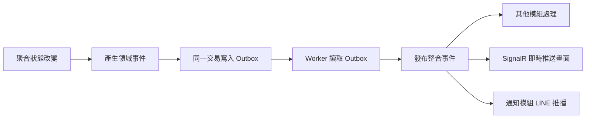

# 物業社區管理平台 SaaS 版 — 技術需求書

| 項目 | 內容 |
|---|---|
| 文件版本 | v1.0（由 SaaS 版需求書 v0.9 第 3.5～3.11 節獨立而成） |
| 撰寫日期 | 2026-11-07 |
| 文件狀態 | 技術選型與架構已確認；開發期間依實作回饋調整 |
| 相關文件 | 《SaaS 版需求規劃書》（`社區管理系統SaaS版需求規劃書.md`，以下簡稱「**需求書**」）、《SaaS 商業計畫書》（`SaaS商業計畫書.md`） |

---

## 1. 文件說明

### 1.1 目的與範圍

本文件說明 SaaS 版的**技術選型、前後端架構、效能設計、開發規範、資安開發流程與測試關卡**，供開發、測試與維運團隊依循。功能需求、非功能需求（資安與效能目標）以需求書為準；本文件說明「如何做到」。

### 1.2 與需求書的關係

| 需求書章節 | 本文件對應 |
|---|---|
| 3 SaaS 系統架構（多租戶模式、前台入口） | 3 後端架構、4 前端架構 |
| 8.2～8.6 資安需求 | 6 開發規範、7 資安開發流程 |
| 8.7 效能評估與目標 | 5 效能設計原則、8 測試關卡 |
| 8.8 上線門檻 | 8 品質與測試關卡 |

### 1.3 已確認的決策（2026-11-07）

| 決策 | 結果 |
|---|---|
| 前後端 | 分離 |
| 前端 | Vue 3＋TypeScript；4 個 App 分開建置；後台 Element Plus，LINE 前台與行動版 Vant |
| 後端 | .NET 10 LTS；DDD 模組化單體；認證服務獨立部署 |
| 資料庫 | PostgreSQL |
| 限界上下文 | 社區帳務與社區財務分成兩個上下文 |
| 品質要求 | 效能與可維護性優先；必須通過弱點掃描、壓力測試、資安測試 |

---

## 2. 技術選型

> 2026-11-07 確認：**前後端分離**；前端 **Vue 3**，後端 **.NET**，資料庫 **PostgreSQL**。前後端內部架構見 3～4，效能、開發規範、資安開發流程與測試關卡見 5～8。

### 2.1 選型結果

| 層級 | 選擇 | 版本建議 |
|---|---|---|
| 前端 | Vue 3＋TypeScript＋Vite | Vue 2 以上 |
| 後端 | .NET（ASP.NET Core） | **.NET 10 LTS** |
| 資料庫 | **PostgreSQL** | 17 以上，使用雲端託管服務 |
| 快取 | Redis | — |
| 即時推送 | SignalR | — |
| 部署 | Docker 容器 | 雲端與企業方案（單一租戶）共用同一套映像 |

### 2.2 選型依據

**影響技術選擇的需求**

| 需求 | 對技術的要求 |
|---|---|
| 多租戶、租戶隔離列為資安第一優先（NF-SAAS-01） | ORM 能自動加上租戶條件；資料庫支援 Row-Level Security |
| 第 3 年規模：12,000 社區、12 萬使用者、尖峰每秒 2,000 次請求（需求書 8.7） | 主流框架都能應付；瓶頸在資料庫與 I/O，不在程式語言 |
| 商業功能多：管理費、社區財務、PDF 月報、Excel 匯入匯出 | 需要成熟的商業應用生態 |
| 登入資安：2FA、Passkey、Argon2id，認證服務獨立部署（8.4、NF-PF-11） | 需要成熟的身分驗證套件 |
| 跨頁面即時更新、LINE 推播與 Webhook | 需要 WebSocket 與背景工作 |
| 企業方案：單一租戶、可地端部署（需求書 5.11） | 容器化，資料庫授權成本要低 |
| 雲端服務商尚未決定（S9） | 不綁定特定雲端 |

**後端：選 .NET，不選 Rust**

| 比較 | .NET 10 | Rust |
|---|---|---|
| 效能 | 足以應付設計規模 | 最高，但本系統用不到 |
| 開發速度 | 快，商業系統套件齊全 | 慢，業務邏輯開發成本高 |
| 多租戶 ORM | EF Core 全域查詢篩選器 | 需自行補齊 |
| PDF、Excel | QuestPDF、ClosedXML 成熟 | 選擇少 |
| 身分驗證 | ASP.NET Core Identity、OpenIddict、Fido2 | 需自行組合，風險較高 |
| 台灣人才 | 多 | 少、成本高 |

**資料庫：選 PostgreSQL，不選 SQL Server**

| 比較 | PostgreSQL | SQL Server |
|---|---|---|
| Row-Level Security | 有 | 有 |
| 授權成本 | 免費 | 高（每 2 核心授權約數千美元等級，以官方報價為準） |
| 企業方案交付 | 客戶不需另購授權 | 客戶需另購或已有授權 |
| 雲端支援 | Azure、GCP（台灣有機房）、AWS 皆有一級託管服務 | Azure 最佳，其他雲端授權費較高 |
| JSON 資料 | jsonb，適合可自訂的稽核範本與表單 | 有，新版才有原生 JSON 型別 |
| 中文全文檢索 | 需外掛；以 pg_trgm 處理名稱、戶別等模糊搜尋 | 內建繁體中文斷詞 |

> 主要理由：資料庫授權是 SaaS 的長期固定成本；企業方案交付時客戶不需另購授權；雲端服務商尚未決定（S9），PostgreSQL 在各家雲端都有一級支援。若日後確定採用 Azure 且以中文全文檢索為核心需求，可重新評估。

### 2.3 主要套件與元件

| 用途 | 前端 | 後端 |
|---|---|---|
| 介面元件 | Element Plus（後台）、Vant（LINE 前台、行動版） | — |
| 狀態與資料 | Pinia、TanStack Vue Query | EF Core（Npgsql）、Dapper（查詢與報表） |
| 多語系 | vue-i18n（繁中、英、印尼、越南、泰文） | 資源檔＋代碼表多語名稱 |
| 身分驗證 | OIDC 用戶端；LINE LIFF SDK | ASP.NET Core Identity＋OpenIddict（獨立部署）、TOTP、Fido2（Passkey）、Argon2id |
| 即時更新 | SignalR 用戶端 | SignalR |
| 背景工作 | — | Hangfire（PostgreSQL 儲存），緊急推播獨立佇列 |
| 報表 | ECharts | QuestPDF（PDF）、ClosedXML（Excel） |
| 檔案 | — | 物件儲存＋短效簽章網址；ImageSharp（壓縮、移除 EXIF） |
| 離線 | vite-plugin-pwa、IndexedDB（巡邏 PWA 備案） | — |
| 驗證與記錄 | — | FluentValidation、Serilog、OpenTelemetry |
| 測試 | Vitest、Playwright | xUnit、Testcontainers（PostgreSQL）、k6（壓力測試） |

### 2.4 注意事項

- **QuestPDF 授權**：年營收 100 萬美元以下可免費使用，超過需購買商業授權。
- **LINE SDK**：.NET 沒有 LINE 官方 SDK，可用社群版本或自行包裝 Messaging API（標準 REST）。
- **授權變更的套件**：MediatR、AutoMapper 已改為商業授權，改用 MIT 授權的替代方案（Mediator 原始碼產生器版本、Mapperly，見 3.8）。
- **雲端（S9）**：選擇 Azure、GCP 或 AWS 都不影響本選型。

---

## 3. 後端架構（DDD 模組化單體）

> 2026-11-07 確認：後端採 **DDD**，以**模組化單體**實作；**效能與可維護性優先**，並以嚴格的開發規範與自動化關卡把關（6～8）。

### 3.1 整體做法

- **一個部署單位，內部依限界上下文（Bounded Context）切成模組**；先不拆微服務，邊界從第一天就嚴格切開，日後可把單一模組獨立出去。
- **模組之間不得直接存取彼此的資料**，只能透過整合事件或模組公開的介面（Contracts）。
- **單一資料庫、每個模組各自一個 schema**（例：`workforce`、`vendor`）。
- **部署單位**：租戶 API、平台 API（獨立網域，NF-AUTH-12）、認證服務（獨立部署，NF-PF-11）、Worker（背景工作）。

### 3.2 限界上下文

| 類型 | 上下文 | 涵蓋內容 | 對應需求 |
|---|---|---|---|
| 核心 | 現場作業 Field Operations | 報修工單、事件通報、交接日誌、巡邏、包裹、訪客、公設預約、設備保養 | F-REP、F-INC、F-SHIFT、F-PAT、F-PKG、F-VIS、F-FAC、F-MNT |
| 核心 | 人事與出勤 Workforce | 員工、證照、派駐、排班、打卡、補卡、請假、薪資資料匯出 | B-EMP、B-SCH、F-ATT、P-PAY |
| 核心 | 品質稽核 Quality | 稽核範本、巡點紀錄、改善單 | B-AUD、F-AUD |
| 核心 | 廠商與合約 Vendor | 廠商、社區廠商合約、付款排程、履約、前台送出 | B-VND、F-VND |
| 核心 | 社區帳務 Community Billing | 戶別、區權人、車位、費率、帳單、收款、收據、催繳 | B-FEE、F-FEE、F-RES |
| 核心 | 社區財務 Community Finance | 科目、資金帳戶、收支、簽核、零用金、對帳、封帳、管委會月報 | B-FIN、F-FIN |
| 支援 | 組織與社區 Organization | 組織樹、社區、法人、管委會、服務合約、設備清冊 | B-SITE、B-CONT、P-TEN-04 |
| 支援 | 經營分析 Business Insight | 社區損益、毛利、預警；以唯讀模型為主，彙總其他模組的事件 | B-BIZ |
| 支援 | 平台營運 Platform | 租戶、方案與授權、計費、潛在客戶、推薦夥伴、客服、公告、條款、企業方案金鑰 | P-TEN、P-SUB、P-BILL、P-CRM、P-PTN、P-SUP、P-CMS、P-ENT |
| 通用 | 身分與權限 Identity（獨立部署） | 帳號、2FA、Passkey、Session、角色權限、LINE 綁定、櫃台裝置 | NF-AUTH、P-LINE-02 |
| 通用 | 通知 Notification | LINE 推播、Email、每日摘要、推播配額、收件匣 | P-LINE-08～10 |
| 通用 | 稽核日誌、匯出與檔案 | 防竄改日誌、完整匯出、檔案儲存 | NF-SVC-08、P-EXIT |

> 社區帳務與社區財務屬同一個加購模組，但業務規則差異大，**分成兩個上下文**（2026-11-07 確認）；管理費收款以整合事件自動產生收入帳。

### 3.3 方案結構與分層

```
src/
├─ BuildingBlocks/          共用基礎（不含業務邏輯）
│  ├─ SharedKernel/         Entity、AggregateRoot、ValueObject、DomainEvent、TenantId、SiteId、Money、DateRange、Result
│  ├─ Application/          命令／查詢介面、交易、目前使用者與租戶
│  └─ Infrastructure/       EF Core 基底、多租戶（篩選＋RLS）、Outbox、事件匯流排、快取、檔案儲存
├─ Modules/<上下文>/
│  ├─ <上下文>.Domain/         聚合、值物件、領域事件、領域服務（不依賴任何框架）
│  ├─ <上下文>.Application/    命令、查詢、事件處理、權限檢查
│  ├─ <上下文>.Infrastructure/ EF 對應、Repository、schema、外部服務
│  ├─ <上下文>.Api/            端點（Minimal API）
│  └─ <上下文>.Contracts/      對外公開：整合事件、查詢介面
├─ Hosts/
│  ├─ Api.Tenant/           租戶 API（租戶後台、網頁前台、LINE 前台共用）
│  ├─ Api.Platform/         平台營運 API
│  ├─ Identity/             認證服務
│  └─ Worker/               Outbox 派送、LINE 推播、帳單批次、報表、匯出
tests/
├─ ArchitectureTests/       自動檢查分層與模組邊界
├─ Modules.*.Tests/         領域單元測試
├─ IntegrationTests/        Testcontainers（PostgreSQL）、跨租戶存取測試
└─ LoadTests/               k6 壓力測試腳本
```

**依賴方向**：`Api → Application → Domain`；`Infrastructure` 實作 `Application` 定義的介面；Domain 層不依賴 EF Core 或 ASP.NET。模組之間只能參考對方的 `Contracts`。以上規則由架構測試自動檢查，違反即無法合併。

### 3.4 聚合設計範例

| 聚合 | 不變條件（由聚合本身保證） |
|---|---|
| VendorContract 廠商合約 | 甲方為本公司時必須指定法人；管委會合約續約或解約需有決議並經督導核准；版本只能新增不能修改 |
| WorkOrder 報修工單 | 狀態機：待處理 → 處理中 → 待料／外包 → 已完成 → 結案；結案必須有處理紀錄；只有總幹事能結案 |
| LeaveRequest 請假 | 總幹事初審 → 督導核准；申請人與核准人不得為同一人 |
| Bill／Payment 帳單與收款 | 一筆收款可沖銷多期帳單；溢繳轉預收；已封帳期間不得修改，只能開調整單 |
| PeriodClose 封帳 | 封帳後該期收支全部鎖定；簽核影像未上傳不得封帳 |
| Tenant 租戶 | 社區數不得超過方案級距；3 年預付期間不得降級 |

### 3.5 模組間溝通：領域事件＋Outbox



| 事件 | 接收模組與動作 |
|---|---|
| WorkOrderAssigned | 通知：LINE 推播給被指派的機電 |
| IncidentReported（緊急） | 通知：走緊急獨立佇列推播督導（NF-PF-16） |
| PaymentRecorded（社區帳務） | 社區財務：自動產生收入帳（B-FIN-05） |
| ServiceLogConfirmed（廠商） | 廠商：重算履約率；經營分析：更新唯讀模型 |
| EmployeeTerminated（人事） | 身分：停用帳號、解除 LINE 綁定、撤銷 Session（NF-AUTH-14） |
| TenantPlanChanged（平台） | 各模組：清除功能授權快取 |

> 使用 Outbox，確保「資料已存檔但推播未送出」的不一致不會發生；事件處理必須可重複執行而結果相同（冪等）。

### 3.6 命令與查詢分離（輕量 CQRS）

- **寫入**：一律經過聚合檢查規則，以 EF Core 存檔。
- **讀取**：直接查詢資料庫（Dapper 或 EF 唯讀查詢），不經過聚合；列表一律伺服器端分頁。
- **儀表板與經營分析**：讀取預先彙總的資料表（NF-PERF-08），由事件或排程更新。

### 3.7 多租戶與權限

- 租戶一律從登入權杖取得，不採用前端傳入的租戶參數。
- **EF Core 全域篩選＋每次連線設定 `app.tenant_id`，搭配 PostgreSQL RLS，兩層防護**（NF-SAAS-01）。
- 平台 API 使用另一組資料庫角色，只能存取平台資料表。
- 權限一律在伺服器端檢查「角色 × 資料範圍（社區）× 方案授權」，廠商合約的權限細項（需求書 5.10.6）也走同一套機制。

### 3.8 套件選擇（避開授權風險）

| 用途 | 選擇 | 說明 |
|---|---|---|
| 命令／查詢分派 | Mediator（原始碼產生器版本，MIT） | MediatR 已改為商業授權 |
| 物件轉換 | Mapperly（原始碼產生器） | AutoMapper 已改為商業授權 |
| 驗證 | FluentValidation | — |
| 背景工作 | Hangfire（PostgreSQL 儲存） | 緊急推播使用獨立佇列與工作程序 |

---

## 4. 前端架構（Vue 3 monorepo）

> 2026-11-07 確認：**4 個 App 分開建置**；後台元件庫使用 **Element Plus**，LINE 前台與行動版使用 **Vant**。

### 4.1 結構（pnpm workspaces）

```
frontend/
├─ apps/
│  ├─ admin/       租戶後台（Element Plus）
│  ├─ ops/         平台營運後台（Element Plus，獨立網域）
│  ├─ liff/        LINE 前台（Vant，輕量）
│  └─ site/        網頁前台：櫃台模式、個人登入、PWA（離線巡邏備案）
└─ packages/
   ├─ api/         由後端 OpenAPI 自動產生的型別與 API 用戶端
   ├─ ui/          共用元件與設計變數（深淺色、長輩友善大字級）
   ├─ i18n/        五種語系文字資源（依頁面分批載入）
   ├─ auth/        登入、2FA、權杖更新、再驗證（step-up）
   ├─ realtime/    SignalR 連線；收到事件即讓對應的資料快取失效
   └─ config/      TypeScript、ESLint、Vite 共用設定
```

每個 App 內部依「功能」分資料夾，對齊後端模組：

```
apps/admin/src/
├─ features/<功能>/   pages/、components/、composables/、queries.ts、permissions.ts
├─ app/               路由、版面、全域守衛（登入、權限、方案授權）
└─ main.ts
```

### 4.2 狀態管理

| 類型 | 工具 | 用途 |
|---|---|---|
| 伺服器資料 | TanStack Vue Query | 快取、重新抓取、分頁；收到 SignalR 事件即讓對應快取失效 |
| 前端狀態 | Pinia（少量） | 目前使用者、選擇中的社區、介面偏好 |
| 表單 | VeeValidate＋Zod | 前端驗證（後端一律再驗證） |

### 4.3 各 App 重點

| App | 重點 |
|---|---|
| admin、ops | 路由守衛同時檢查權限與方案授權，未授權功能顯示鎖頭；高風險操作使用共用的再驗證元件 |
| liff | LINE 登入取得 ID Token，交由後端驗證後換成系統權杖（NF-AUTH-07）；程式大小由 CI 檢查 |
| site | 櫃台模式（工號＋PIN）與個人登入分開；IndexedDB 離線佇列，恢復連線後補送 |

---

## 5. 效能設計原則

### 5.1 後端

| 項目 | 規範 |
|---|---|
| 非同步 | 所有 I/O 非同步並可取消；禁止同步等待（`.Result`、`.Wait()`） |
| 查詢 | 讀取一律唯讀查詢、只取需要的欄位；禁止 N+1（測試自動偵測）；熱門查詢預先編譯 |
| 分頁 | 一律伺服器端分頁；大量資料（打卡、巡邏、收支）使用游標式分頁 |
| 索引與分割 | 索引以 `tenant_id` 為第一欄位；大表依租戶或年度分割；新查詢需附執行計畫 |
| 讀寫分離 | 報表與分析查詢走唯讀副本 |
| 快取 | Redis，鍵值包含租戶 ID；資料變更以事件使快取失效 |
| 預先彙總 | 儀表板與經營分析讀取彙總表，不即時掃描明細 |
| 背景處理 | 帳單批次、PDF、匯出交由 Worker；緊急推播獨立佇列 |
| 連線與流量 | 資料庫連線池；依租戶限流；回應壓縮 |
| 效能預算 | 每個 API 對應需求書 8.7.3 的目標，由應用效能監控持續追蹤 |

### 5.2 前端

| 項目 | 規範 |
|---|---|
| 程式大小 | 依路由拆分載入；LINE 前台每頁 ≤ 200 KB、後台首頁 ≤ 350 KB（壓縮後）；超過即無法合併 |
| 載入速度 | LINE 前台 4G 網路首次開啟 ≤ 2.5 秒；Lighthouse 效能分數 ≥ 90 |
| 大量資料 | 長列表虛擬捲動；大陣列使用淺層響應式 |
| 圖片 | 上傳前前端壓縮；列表只載入縮圖 |
| 多語系 | 依頁面分批載入語系檔 |
| 資料更新 | 以即時事件觸發重新抓取，不使用輪詢 |

---

## 6. 可維護性與開發規範

### 6.1 可維護性

| 項目 | 做法 |
|---|---|
| 邊界自動把關 | 架構測試檢查分層與模組邊界；前端 feature 之間不得互相引用 |
| 一致的寫法 | 每個使用情境一個命令或查詢處理器，結構固定；新功能依範本產生 |
| API 契約優先 | 後端產生 OpenAPI，前端自動產生型別；CI 偵測未宣告的破壞性變更 |
| 資料庫變更 | 只用遷移腳本；採「先擴充、後收斂」，不得直接刪除欄位；每次遷移驗證可回復 |
| 決策紀錄 | 重要架構決策以架構決策紀錄（ADR）保存在版本庫 |
| 測試覆蓋率 | Domain ≥ 90%、Application ≥ 80%、前端共用套件 ≥ 80%；低於門檻即無法合併 |
| 功能開關 | 新功能以功能開關上線，避免長期分支 |

### 6.2 開發流程

| 項目 | 規範 |
|---|---|
| 分支 | 短期分支，一律透過 Pull Request 合併，禁止直接推送主分支 |
| 審查 | 每個 PR 至少 1 人審查；**資安敏感模組（身分驗證、平台、帳務、多租戶基礎）至少 2 人**，並指定負責人 |
| Commit | Conventional Commits；版本號採語意化版本 |
| 完成定義 | 測試通過、覆蓋率達標、沒有新的資安問題、文件已更新、可以回復 |

### 6.3 程式規範

| 範圍 | 規範 |
|---|---|
| 後端（C#） | 啟用可為 null 型別檢查；**警告視為錯誤**；啟用 .NET 官方與資安分析器、`.editorconfig`；禁止 `async void`；必須傳遞取消權杖；業務錯誤以結果物件回傳，不以例外控制流程；結構化日誌，**日誌禁止出現個資與權杖**（過濾器自動遮罩並以測試驗證） |
| 前端（TypeScript） | 嚴格模式，**禁止 `any`**；ESLint 嚴格規則＋Prettier；統一使用 `<script setup>`；**禁止 `v-html`**，除非內容經 DOMPurify 清理並經審查；權杖不存 localStorage（存取權杖放記憶體，更新權杖放 HttpOnly Cookie） |
| 資料庫 | 命名使用小寫加底線；**每張業務資料表必須有 `tenant_id` 與 RLS 政策**，由自動測試逐表檢查 |

---

## 7. 資安開發流程

| 階段 | 做法 |
|---|---|
| 設計 | 核心模組（身分、多租戶、帳務、平台）開發前進行威脅建模，對照需求書 8.2 風險清單 |
| 開發 | 依 OWASP ASVS Level 2 檢核表開發；安全預設值；所有輸入驗證、所有輸出編碼 |
| 前端 | 嚴格內容安全政策（CSP），不允許行內程式碼；CSRF 防護；第三方套件鎖定版本 |
| 供應鏈 | lock 檔鎖定版本；每次建置產生軟體物料清單（SBOM）；只使用允許的套件來源 |
| 容器 | 最小化基礎映像、以非 root 執行、映像簽章 |
| 機密 | 一律存放於雲端金鑰管理服務；版本庫出現機密即擋下 |

---

## 8. 品質與測試關卡

> 前後端都**必須通過弱點掃描、壓力測試與資安測試**。以下關卡為自動化強制執行，與需求書 8.8 上線門檻一致。

### 8.1 每個 Pull Request（未通過無法合併）

| 檢查 | 工具 | 通過標準 |
|---|---|---|
| 建置與程式風格 | dotnet build、ESLint、型別檢查 | 0 錯誤、0 警告 |
| 單元與架構測試 | xUnit、Vitest、架構測試 | 全部通過，覆蓋率達標 |
| 跨租戶存取測試 | 整合測試（真實 PostgreSQL） | 全部被拒絕（G1） |
| 靜態程式碼掃描（SAST） | CodeQL 或 SonarQube | 0 個重大、0 個高風險 |
| 套件弱點掃描（SCA） | OSV-Scanner、dotnet 與 npm 弱點檢查 | 0 個重大、0 個高風險 |
| 機密掃描 | gitleaks | 0 筆 |
| 容器掃描 | Trivy | 0 個重大、0 個高風險 |
| API 契約 | OpenAPI 比對 | 沒有未宣告的破壞性變更 |
| 前端效能預算 | size-limit | 不超過預算 |

### 8.2 每日（測試環境自動執行）

| 檢查 | 工具 | 通過標準 |
|---|---|---|
| 動態弱點掃描（DAST） | OWASP ZAP | 0 個高風險；中風險依時限修補 |
| 壓力測試（煙霧版） | k6 | 主要 API 達到 8.7.3 效能目標 |
| 端對端測試 | Playwright | 全部通過，沒有無作用的按鈕 |
| 前端效能 | Lighthouse CI | LINE 前台效能分數 ≥ 90 |

### 8.3 每次重大版本（需求書 8.8 上線門檻）

| 檢查 | 通過標準 |
|---|---|
| 完整壓力測試 | 以第 3 年規模模擬 8.7.2 全部尖峰情境（交接班每秒 2,000 次、照片上傳、每日摘要推播、帳單批次、撞庫攻擊、多租戶公平性），全部達到效能目標，錯誤率 < 0.1% |
| 長時間測試 | 連續 8 小時，記憶體與回應時間不得逐漸變差 |
| 第三方滲透測試 | 沒有未修補的高風險項目 |
| 資料庫還原演練 | 驗證可以回復 |

> 弱點修補時限沿用 NF-SVC-10：重大 7 天、高風險 30 天、中風險 90 天。
