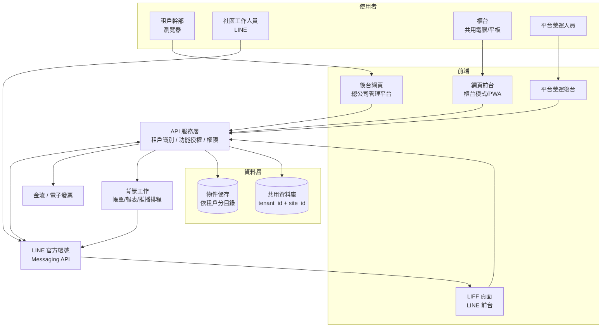
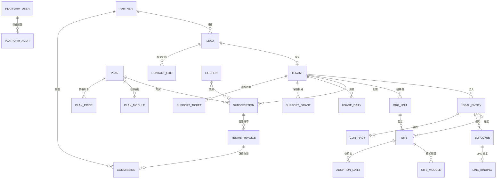

# 物業社區管理平台 SaaS 版 — 需求規劃書

| 項目 | 內容 |
|---|---|
| 文件版本 | v0.2（新增平台營運後台、選單結構） |
| 撰寫日期 | 2026-11-06 |
| 文件狀態 | 需求草案，待訪談與試用驗證後調整 |
| 基礎文件 | 原需求規劃書 v0.5（`../社區管理系統需求規劃書.md`），以下簡稱「**原需求書**」 |
| 相關文件 | 《SaaS 商業計畫書》（`SaaS商業計畫書.md`） |

---

## 1. 文件說明

### 1.1 撰寫方式

原需求書是為**單一物業公司**規劃的。評估後，大部分功能可以直接用在 SaaS（見第 2 章），因此本文件採**差異式**撰寫：

- **沿用**：原需求書第 3、4 章的功能需求（`B-*`、`F-*` 編號）原則上沿用，編號不變，本文件不重複列出。
- **調整**：需要因 SaaS 修改的原需求，列在第 6 章，並標明原編號。
- **新增**：SaaS 平台本身需要的功能（租戶、訂閱、計費、LINE 前台、使用率監控等），以新編號列在第 5 章。
- **方案歸屬**：每個模組屬於哪個版本，列在第 7 章。

> 閱讀時請搭配原需求書。若兩份文件有衝突，**以本文件為準**。

### 1.2 名詞定義

| 名詞 | 說明 |
|---|---|
| **平台** | 本 SaaS 服務本身，由我方營運 |
| **租戶（Tenant）** | 一個訂閱客戶，通常是一家物業公司或一個物業集團 |
| **法人** | 租戶底下實際簽約、雇用員工的公司。一個租戶可有多個法人（例：同集團的保全公司與物業管理公司） |
| **方案** | 訂閱內容，由「版本（基本／專業／旗艦）」與「社區數級距」組成 |
| **功能授權** | 依方案決定租戶可使用哪些模組 |
| **LINE 前台** | 社區工作人員透過 LINE 官方帳號的圖文選單與 LIFF 頁面操作前台功能 |
| **平台營運後台** | 平台營運方（我們）使用的管理系統，管理租戶、方案、帳務、推薦夥伴、客服、內容與系統 |
| **推薦夥伴** | 介紹客戶給平台並收取佣金的個人或公司（例：業主） |

### 1.3 需求編號規則

| 前綴 | 範圍 |
|---|---|
| `B-*`、`F-*` | 沿用原需求書 |
| `P-*` | 本文件新增的平台需求：租戶端（P-TEN 租戶、P-SUB 訂閱、P-BILL 計費、P-ONB 導入、P-LINE LINE 前台、P-ADOPT 使用率、P-EXIT 退租、P-HELP 教學）；平台營運後台（P-DASH 儀表板、P-CRM 客戶開發、P-OPS 租戶管理、P-PTN 推薦夥伴、P-SUP 客服、P-CMS 內容管理、P-MON 系統監控、P-ADM 平台設定） |
| `NF-SAAS-*` | 本文件新增的非功能需求 |

優先級沿用原需求書：**P0** = SaaS 上市必要、**P1** = 第二期、**P2** = 未來擴充。

---

## 2. 原功能 SaaS 化評估

### 2.1 評估結論

1. **原功能大多可直接沿用**。原需求書在設計時已具備多項 SaaS 必要條件：組織架構可自訂、所有資料以 `site_id` 為邊界、不預設社區數量上限、可水平擴充、記帳模式與收費設定可依社區個別調整、多語系。
2. **需要補上的是「平台層」**：租戶隔離、訂閱與功能授權、計費、客戶導入、平台營運後台。這些原需求書沒有，因為原本只有一個客戶。
3. **前台要重新設計入口**：業主不導入的原因是總幹事年長、學習曲線高。前台改以 **LINE 為主要入口**，原本的 PWA 網頁保留給櫃台模式與不使用 LINE 的人員。
4. **原本「業主確認」的決策要改成「租戶可設定」**：例如打卡、薪資串接、法人數量，不同客戶答案不同（見 2.3）。
5. **範圍要分版本**：原需求書 P0 範圍很大（含管理費、社區財務、經營分析）。SaaS 版拆成三個版本，基本版先上市（見第 7 章）。

### 2.2 逐模組評估

**評估等級說明**：

- **A 直接沿用**：功能不用改，只需加上租戶隔離。
- **B 參數化**：功能沿用，但原本寫死或業主確認的部分要改成租戶可設定，或提供平台預設範本。
- **C 重新設計**：互動方式或架構需要明顯調整。
- **D 延後／加購**：不放在上市範圍，或改為加購模組。

#### 後台模組

| 原模組 | 評估 | 說明 | 版本 |
|---|---|---|---|
| 3.1 儀表板 B-DASH | B | 依租戶的方案只顯示有授權的區塊；新增「使用率」區塊（P-ADOPT） | 基本 |
| 3.2 社區管理 B-SITE | B | 沿用；新增「社區所屬法人」與「模組開關」（P-SUB-05）；社區數受方案級距控管 | 基本 |
| 3.3 合約管理 B-CONT | B | 沿用；合約需指定簽約法人（同一社區的保全合約與物業合約可能由不同法人簽訂） | 基本 |
| 3.4 員工／人事 B-EMP | B | 沿用；員工需指定所屬法人；證照類別改由平台提供預設清單，租戶可增修 | 基本 |
| 3.5 排班與出勤 B-SCH | A | 沿用；打卡相關仍暫緩，改列為加購候選（見 2.3） | 基本 |
| 3.6 督導稽核 B-AUD | B | 沿用；平台提供**稽核範本庫**（物業、保全、清潔常用範本），租戶可複製後修改 | 專業 |
| 3.7 工單與事件 B-OPS | A | 沿用 | 基本（廠商管理屬專業） |
| 3.8 公告與文件 B-DOC | A | 沿用；平台另需「平台公告」（版本更新、維護通知），見 P-OPS | 基本 |
| 3.9 報表中心 B-RPT | B | 沿用；報表依方案授權顯示；大型匯出需依租戶排隊，避免影響其他租戶 | 基本／專業 |
| 3.10 系統設定 B-SYS | C | 帳號、角色、代碼表改為「平台預設＋租戶覆寫」；通知設定改由 P-LINE 與通知中心處理；資料匯入中心是**導入關鍵**，提升為平台核心能力 | 基本 |
| 3.11 管理費收繳 B-FEE | B | 功能沿用；原本已可依社區設定款項流向與收據名義，適合多客戶；收據抬頭可選法人 | 旗艦 |
| 3.12 社區財務 B-FIN | B | 功能沿用；平台提供預設會計科目表；記帳模式本來就可依社區設定 | 旗艦 |
| 3.13 公司經營分析 B-BIZ | B | 沿用；新增「依法人」檢視損益；職位標準成本由租戶自行設定，平台提供範本 | 旗艦 |

#### 前台模組

| 原模組 | 評估 | 說明 | 版本 |
|---|---|---|---|
| 4.1 工作台 F-HOME | C | 改為 **LINE 圖文選單**（依角色顯示不同選單）；櫃台模式保留網頁版工作台 | 基本 |
| 4.2 班表與請假 F-ATT | C | 班表查詢、請假申請改為 LIFF 頁面；打卡延後為加購 | 基本 |
| 4.3 交接班日誌 F-SHIFT | C | 改為 LIFF 頁面，提供常用範本與語音輸入；接班人在 LINE 一鍵確認 | 基本 |
| 4.4 住戶資料 F-RES | B | 基本版只需「戶別清單」（供包裹、報修選戶別）；區權人、坪數、應繳管理費等完整欄位屬旗艦版 | 基本（戶別）／旗艦（完整） |
| 4.5 包裹 F-PKG | A | 沿用；櫃台多為共用電腦，以網頁版為主，LINE 提供查詢 | 基本 |
| 4.6 訪客 F-VIS | A | 沿用；以網頁版櫃台模式為主 | 基本 |
| 4.7 報修 F-REP | C | 改為 LIFF「拍照 → 選類別 → 送出」三步流程 | 基本 |
| 4.8 巡邏打點 F-PAT | C | 掃碼改用 LIFF 開啟相機掃 QR Code；離線暫存需另行評估（LIFF 環境限制較多） | 專業 |
| 4.9 設備保養與清潔 F-MNT | A | 沿用 | 專業 |
| 4.10 公設預約 F-FAC | A | 沿用 | 專業 |
| 4.11 事件通報 F-INC | C | 改為 LIFF「拍照 → 選等級 → 送出」；緊急事件以 LINE 推播通知督導 | 基本 |
| 4.12 公告 F-NEWS | C | 公司公告改由 LINE 推送，點開即標記已讀 | 基本 |
| 4.13 稽核改善回覆 F-AUD | C | 改善單以 LINE 通知總幹事，於 LIFF 頁面拍照回覆 | 專業 |
| 4.14 管理費櫃台 F-FEE | A | 沿用；櫃台收款與列印收據以網頁版為主 | 旗艦 |
| 4.15 社區財務作業 F-FIN | B | 支出登錄、拍憑證可走 LIFF；封帳與月報產出以網頁版為主 | 旗艦 |

#### 非功能需求

| 原章節 | 評估 | 說明 |
|---|---|---|
| 7.1 資安與個資 | B | 沿用；新增租戶隔離、平台受託處理個資的責任（見第 8 章） |
| 7.2 可用性與效能 | A | 原本即以大量社區、水平擴充設計，適合多租戶；新增租戶間資源公平（見 NF-SAAS-06） |
| 7.3 使用體驗 | B | 長輩友善、多語系、櫃台模式全部保留，且成為**產品主要賣點**；PWA 改為 LINE 的輔助管道 |
| 8. 技術架構 | C | 部署確定採雲端多租戶；通知以 LINE 官方帳號為主（見第 3 章） |

#### 統計

| 評估 | 模組數 | 比例 |
|---|---|---|
| A 直接沿用 | 9 | 約 28% |
| B 參數化 | 13 | 約 41% |
| C 重新設計 | 10 | 約 31%（多數是前台改為 LINE，業務邏輯不變） |
| 合計 | 32 | 後台 13、前台 15、非功能 4 |

> 重新設計的部分主要是「**操作介面**」，資料模型與業務規則幾乎不變。後端 API 可以共用，LINE 前台與網頁前台呼叫同一套 API。

### 2.3 原「業主確認」決策的 SaaS 處理方式

原需求書第 10 章有許多依單一業主決定的事項，SaaS 版需重新處理：

| 原題號 | 原決定 | SaaS 版處理 |
|---|---|---|
| Q1 社區數量 | 不設上限 | **沿用**；社區數改由方案級距控管（P-SUB-04） |
| Q2 人員是否分屬不同公司 | 同一家公司 | **改為支援多法人**：一個租戶可有多個法人，員工、合約、收據可指定法人（P-TEN-04） |
| Q3 組織層級 | 樹狀自訂 | **沿用**，每個租戶各自一棵組織樹 |
| Q4 打卡 | 暫緩 | **改為加購模組候選**：不少客戶可能需要；以 LIFF 取得位置打卡，訪談後決定優先級 |
| Q5 薪資系統 | 待確認 | **不做個別串接**；提供標準格式匯出（CSV/Excel）及欄位對應設定（P1） |
| Q6 管理費 | 納入、依社區設定 | **沿用**，屬旗艦版 |
| Q7 管委會登入 | 不需要 | **沿用**；管委會唯讀入口列為 P2 評估項目（可能成為加值功能） |
| Q8 住戶端 | 不需要 | **沿用**，維持「服務物業公司本身」的定位 |
| Q9 員工特性 | 年長、外籍、櫃台共用 | **沿用並強化**，是產品主要差異化 |
| Q10 資料匯入 | 全部匯入 | **沿用**；匯入中心提升為平台核心，並提供平台人員代為匯入（P-ONB） |
| Q11 預算與時程 | 未定 | 改由商業計畫書規劃 |
| Q12 部署 | 未定 | **確定雲端多租戶**；60 個社區以上的企業方案可評估專屬環境（P2） |
| Q13 社區財報 | 納入 | **沿用**，屬旗艦版 |
| Q14 經營分析 | 納入 | **沿用**，屬旗艦版；新增依法人檢視 |

---

## 3. SaaS 系統架構

### 3.1 架構示意



### 3.2 資料層級

```
平台
└─ 租戶（物業公司／集團）  ← 訂閱與計費單位
    ├─ 法人（保全公司、物業管理公司…）
    └─ 組織樹（總公司 → 事業處 → 區 → 組，層級自訂）
        └─ 社區  ← 原需求書的資料邊界
            └─ 戶別、報修、包裹、帳務…
```

### 3.3 多租戶模式

| 項目 | 決定 | 說明 |
|---|---|---|
| 資料庫 | **共用資料庫、共用資料表，以 `tenant_id` 區隔** | 維運成本最低，適合中小型客戶；原本的 `site_id` 邊界維持不變 |
| 隔離機制 | 應用層強制過濾＋資料庫層 Row-Level Security 雙重保護 | 任何查詢都必須帶租戶條件，見 NF-SAAS-01 |
| 檔案儲存 | 依租戶分目錄，存取一律透過短效簽章網址 | 避免猜網址讀到別的租戶檔案 |
| 版本 | 所有租戶使用同一版本，以功能開關（Feature Flag）控制新功能逐步開放 | 不為個別客戶維護分支 |
| 企業方案 | 專屬資料庫或專屬環境 | P2，視大型客戶需求再評估 |

### 3.4 前台入口

| 入口 | 使用者 | 使用情境 |
|---|---|---|
| **LINE（主要）** | 總幹事、保全、清潔、機電 | 個人手機操作：交接、報修、通報、請假、公告、改善單 |
| **網頁前台（櫃台模式）** | 櫃台值班人員、秘書 | 共用電腦或平板：包裹、訪客、管理費收款、住戶查詢 |
| **網頁前台（PWA）** | 不使用 LINE 的人員 | 與 LINE 功能相同的備援管道 |

---

## 4. 使用者角色

### 4.1 平台角色（新增）

| 角色代碼 | 角色 | 主要職責 | 資料範圍 |
|---|---|---|---|
| PLAT-ADMIN | 平台管理員 | 方案設定、租戶管理、系統參數、平台公告、平台人員帳號 | 全平台（不含租戶業務資料內容） |
| PLAT-SALES | 業務 | 潛在客戶、試用申請、建立試用租戶、報價 | 自己負責的潛在客戶與租戶 |
| PLAT-SUPPORT | 客服／導入人員 | 協助導入、資料匯入、問題排除、內容管理 | 僅限**租戶授權期間**的指定租戶 |
| PLAT-FIN | 平台財務 | 訂閱帳單、收款對帳、發票、佣金撥付 | 全平台的訂閱、帳單與佣金資料 |
| PARTNER | 推薦夥伴 | 查看自己推薦的客戶與佣金（P1 夥伴入口） | 僅限自己推薦的客戶，且只看名稱、階段、付費狀態 |

> 平台人員**預設看不到**租戶的業務資料（住戶、員工、帳務）。客服需要協助時，必須由租戶管理者開啟限時授權（P-OPS-04），所有操作留下稽核紀錄。

### 4.2 租戶角色

沿用原需求書第 2 章所有角色（HQ-*、SITE-*），另新增：

| 角色代碼 | 角色 | 主要職責 |
|---|---|---|
| TEN-OWNER | 租戶擁有者 | 訂閱方案、付款方式、帳單、發票資訊、授權平台客服存取；每個租戶至少一位 |

> 原 HQ-ADMIN 改為「租戶系統管理員」，權限範圍限於自己的租戶。

---

## 5. 平台新增功能需求

### 5.1 租戶管理（P-TEN）

| 編號 | 需求 | 優先級 |
|---|---|---|
| P-TEN-01 | 建立租戶：公司名稱、統編、聯絡人、租戶代碼（用於登入網址或識別），建立時自動產生租戶擁有者帳號 | P0 |
| P-TEN-02 | 租戶狀態：試用中 / 正式 / 付款逾期 / 唯讀 / 停權 / 已終止，狀態變更保留紀錄 | P0 |
| P-TEN-03 | 租戶基本設定：預設語系、時區、Logo（顯示於後台、LIFF 頁面、PDF 報表） | P0 |
| P-TEN-04 | **多法人**：一個租戶可建立多個法人（名稱、統編、地址、印章圖檔）；員工、合約、收據抬頭可指定法人 | P0 |
| P-TEN-05 | 租戶自訂網域（例：`ops.某公司.com.tw`） | P2 |

### 5.2 訂閱與功能授權（P-SUB）

| 編號 | 需求 | 優先級 |
|---|---|---|
| P-SUB-01 | 方案定義（平台設定）：版本（基本／專業／旗艦）× 社區數級距；每個方案設定可用模組、社區數上限、儲存空間配額、LINE 推播配額 | P0 |
| P-SUB-02 | **功能授權**：API 與畫面依租戶方案檢查模組權限；未授權的功能不顯示選單，直接呼叫 API 時回傳「未授權」 | P0 |
| P-SUB-03 | 試用期：新租戶可設定試用天數（預設 30 天），期滿未付款轉為唯讀 | P0 |
| P-SUB-04 | **社區數控管**：新增或啟用社區時檢查「服務中」社區數；超過級距時提示升級，或依設定自動升級並於次月計費 | P0 |
| P-SUB-05 | **社區模組開關**：租戶可依社區開啟或關閉已授權的模組（例：A 社區只用報修與通報），讓客戶逐步導入 | P0 |
| P-SUB-06 | 升級立即生效、按日計價補差額；降級於下一計費週期生效，降級前檢查是否有資料或社區超出新方案限制 | P1 |
| P-SUB-07 | 加購模組：未來的打卡、薪資匯出等可單獨加購 | P1 |
| P-SUB-08 | 方案異動歷史：每次變更記錄日期、異動前後方案、操作人 | P0 |

### 5.3 計費與帳單（P-BILL）

| 編號 | 需求 | 優先級 |
|---|---|---|
| P-BILL-01 | 依方案自動產生訂閱帳單：月繳或年繳（年繳折扣由平台設定）；導入費等一次性費用可手動新增 | P0 |
| P-BILL-02 | 付款方式：銀行轉帳（人工對帳）為 P0；信用卡定期定額自動扣款（串接國內金流服務）為 P1 | P0 |
| P-BILL-03 | **電子發票**：串接電子發票加值服務，平台收款後自動開立並寄送 | P1 |
| P-BILL-04 | 逾期處理：到期前 7 天提醒 → 逾期 7 天轉「付款逾期」並每日提醒 → 逾期 30 天轉「唯讀」 → 逾期 60 天「停權」；每個階段的天數由平台設定 | P0 |
| P-BILL-05 | 租戶擁有者可在後台查看方案、帳單、付款紀錄、下載發票 | P0 |
| P-BILL-06 | 用量顯示：本月 LINE 推播則數、儲存空間使用量，與方案配額比較 | P1 |

### 5.4 客戶導入（P-ONB）

| 編號 | 需求 | 優先級 |
|---|---|---|
| P-ONB-01 | **導入精靈**：依序引導完成「公司與法人 → 組織架構 → 社區 → 員工 → 角色與帳號 → LINE 綁定」，顯示完成進度 | P0 |
| P-ONB-02 | 資料匯入中心（沿用 B-SYS-10）：標準 Excel 範本、檢核報告、試算預覽、批次撤銷；平台客服可在授權期間代為匯入 | P0 |
| P-ONB-03 | **平台範本庫**：新租戶建立時自動帶入預設的班別、報修類別、事件類別、證照類別、稽核範本、會計科目表、職位標準成本範本；租戶可修改，不影響平台範本 | P0 |
| P-ONB-04 | 示範資料：試用租戶可一鍵產生示範社區與資料，方便體驗；正式使用前可一鍵清除 | P1 |
| P-ONB-05 | 導入檢查清單：列出尚未完成的設定（例：有社區沒有派駐人員、有員工未綁定 LINE） | P1 |

### 5.5 LINE 前台（P-LINE）

| 編號 | 需求 | 優先級 |
|---|---|---|
| P-LINE-01 | **官方帳號架構**：預設全平台共用一個官方帳號；P1 支援租戶使用自己的官方帳號（訊息費由租戶自行負擔，帳號顯示租戶品牌） | P0 |
| P-LINE-02 | **員工綁定**：後台為員工產生一次性邀請碼或 QR Code，員工加入官方帳號後掃碼完成綁定；綁定後 LINE 帳號對應到租戶與員工身分。離職時自動解除綁定 | P0 |
| P-LINE-03 | 一個 LINE 帳號只能綁定一個租戶的一個員工；如需更換租戶（員工跳槽），須先由原租戶解除綁定 | P0 |
| P-LINE-04 | **圖文選單依角色切換**：總幹事、保全、清潔、機電看到不同的選單按鈕；選單文字依員工語系顯示 | P0 |
| P-LINE-05 | **LIFF 頁面**：交接日誌、報修、事件通報、請假、班表、公告、改善單回覆、巡邏掃碼、支出拍照登錄；以原需求書對應功能的業務規則為準 | P0 |
| P-LINE-06 | **三步原則**：報修、事件通報、交接日誌在 LIFF 上 3 步內完成；大按鈕、大字級、圖示配文字；支援語音輸入轉文字（P1） | P0 |
| P-LINE-07 | 派駐多個社區者，LIFF 頁面開啟時先選社區，系統記住上次選擇 | P0 |
| P-LINE-08 | **推播策略**：只對例外狀況即時推播（緊急事件、逾期工單、改善單）；一般待辦合併為每日摘要；推播對象與時段可由租戶設定 | P0 |
| P-LINE-09 | **推播配額**：依方案設定每月推播配額；接近上限時通知租戶擁有者；超出後非緊急通知改為僅在 LIFF 待辦顯示，緊急事件仍照常推播 | P1 |
| P-LINE-10 | 未綁定 LINE 的人員改以 Email 或 PWA 推播通知；重要通知可選擇以簡訊備援（P2） | P1 |

> LINE 官方帳號的訊息費用：回覆訊息與 LIFF 頁面操作不計費，只有主動推播計費。費用估算見商業計畫書 7.2。

### 5.6 使用率監控（P-ADOPT）

> 這是回應「導入後使用率偏低」顧慮的**核心功能**，也是對老闆的主要賣點之一。

| 編號 | 需求 | 優先級 |
|---|---|---|
| P-ADOPT-01 | **租戶使用率儀表板**：依社區、員工顯示近 7／30 天的活躍天數、各功能使用次數（交接日誌、報修、通報、巡邏等） | P0 |
| P-ADOPT-02 | 低使用率警示：社區連續 N 天（預設 3 天）沒有交接日誌或任何操作時，通知負責督導；N 可由租戶設定 | P0 |
| P-ADOPT-03 | LINE 綁定率：各社區派駐人員中已綁定 LINE 的比例 | P0 |
| P-ADOPT-04 | 導入進度：新導入社區前 30 天的使用趨勢，協助督導判斷需不需要再訓練 | P1 |
| P-ADOPT-05 | 使用率納入督導稽核評分項目（選用） | P2 |

### 5.7 平台營運後台（P-OPS 等）

> 平台營運後台是 SaaS 的**第三個端**：租戶（物業公司）使用「租戶後台」與「前台」，平台營運方（我們）使用「平台營運後台」管理客戶、方案、帳務、推薦夥伴、客服與系統。
>
> 平台營運後台與租戶系統使用**獨立的登入入口與帳號**，平台人員帳號不能登入租戶後台；需要協助租戶時，一律透過限時授權（P-OPS-04）。

#### 5.7.1 營運儀表板（P-DASH）

| 編號 | 需求 | 優先級 |
|---|---|---|
| P-DASH-01 | 關鍵指標：月經常性收入（MRR）、年經常性收入（ARR）、付費租戶數、試用中租戶數、服務社區總數、本月新增／流失租戶 | P0 |
| P-DASH-02 | 趨勢圖：近 12 個月 MRR、租戶數、社區數 | P0 |
| P-DASH-03 | 待處理清單：試用即將到期、帳款逾期、流失預警、未結客服問題、待審核試用申請 | P0 |
| P-DASH-04 | 試用轉付費率、平均導入天數（建立租戶到第一個社區正式使用） | P1 |
| P-DASH-05 | 方案分布（版本 × 級距）與各方案營收占比 | P1 |

#### 5.7.2 客戶開發（P-CRM）

| 編號 | 需求 | 優先級 |
|---|---|---|
| P-CRM-01 | **試用申請**：官網表單（公司名稱、統編、聯絡人、電話、Email、社區數、推薦人／推薦碼），送出後進入潛在客戶清單 | P0 |
| P-CRM-02 | 潛在客戶管理：來源（官網、推薦夥伴、展覽、電話開發）、階段（新名單 → 已聯繫 → 已展示 → 試用中 → 議價 → 成交／未成交）、負責業務、預估社區數與月費 | P0 |
| P-CRM-03 | 聯繫紀錄：日期、方式（電話、拜訪、線上展示）、內容、下次跟進日；到期提醒負責業務 | P0 |
| P-CRM-04 | **一鍵建立試用租戶**：由潛在客戶資料直接建立租戶（帶入公司資料、推薦夥伴），寄送開通通知給客戶 | P0 |
| P-CRM-05 | 未成交原因統計（價格、功能不足、員工不會用、已有系統…），供產品與定價調整參考 | P1 |
| P-CRM-06 | 銷售漏斗報表：各階段數量與轉換率，可依來源、推薦夥伴、業務篩選 | P1 |

#### 5.7.3 租戶管理（P-OPS）

| 編號 | 需求 | 優先級 |
|---|---|---|
| P-OPS-01 | 租戶列表：方案、狀態、社區數、使用者數、MRR、到期日、最近活躍時間、健康度；可篩選與匯出 | P0 |
| P-OPS-02 | **流失預警與健康度**：依使用率（P-ADOPT）、LINE 綁定率、帳款逾期、客服問題數計算健康度（良好／注意／危險），危險租戶列入待處理清單 | P1 |
| P-OPS-03 | 平台公告：版本更新、維護時間，可指定全部、特定方案或特定租戶，顯示於租戶後台與 LINE；可排程發布 | P0 |
| P-OPS-04 | **限時授權存取**：租戶管理者開啟授權（例：24 小時），平台客服才能進入該租戶協助；授權到期自動失效；客服的所有操作寫入租戶可查閱的稽核日誌 | P0 |
| P-OPS-05 | 客服問題回報：租戶可在後台與 LIFF 頁面回報問題並附截圖，平台追蹤處理狀態（見 5.7.6） | P1 |
| P-OPS-06 | 功能開關管理：新功能可先對指定租戶開放試用（見 5.7.9） | P1 |
| P-OPS-07 | 平台營運報表：MRR 變動明細（新增、升級、降級、流失）、各方案分布、各租戶 LINE 推播量與儲存用量 | P1 |
| P-OPS-08 | **租戶詳情頁**：同一頁呈現基本資料與法人、目前方案與歷史、帳單與付款、用量與配額、使用率趨勢、導入檢查清單進度（P-ONB-05）、客服問題、聯繫紀錄、推薦夥伴 | P0 |
| P-OPS-09 | 租戶狀態操作：延長試用、轉正式、手動調整方案、暫停、恢復、終止；每次操作需填原因並記錄 | P0 |
| P-OPS-10 | 租戶聯繫紀錄：客戶成功人員的拜訪、電話、訓練紀錄 | P1 |

#### 5.7.4 方案、價格與帳務（P-SUB、P-BILL 營運端）

| 編號 | 需求 | 優先級 |
|---|---|---|
| P-SUB-09 | **方案管理**：設定版本、級距、可用模組、配額、月費、年費；方案可停售（不再提供新客戶，既有客戶續用） | P0 |
| P-SUB-10 | **價格版本**：調價時建立新價格版本並設定生效日；既有租戶可選擇沿用舊價（保留原價）或於指定日期起適用新價 | P1 |
| P-SUB-11 | 優惠碼：折扣方式（百分比／固定金額／免費月數）、適用方案、有效期、使用次數上限 | P1 |
| P-SUB-12 | 個別報價：企業方案或特殊條件可為單一租戶設定專屬價格，需主管核准 | P1 |
| P-BILL-07 | 帳單總覽：本月應收、已收、逾期，依租戶篩選；可手動新增一次性費用（導入費、加購訓練） | P0 |
| P-BILL-08 | **收款對帳**：銀行轉帳收款登記，或匯入銀行明細自動比對帳單金額與虛擬帳號 | P0 |
| P-BILL-09 | 逾期催收：依 P-BILL-04 自動提醒，並記錄人工催收紀錄 | P0 |
| P-BILL-10 | 折讓與退款：方案降級、服務中斷補償時開立折讓單，記錄原因 | P1 |

#### 5.7.5 推薦夥伴與佣金（P-PTN）

> 對應商業計畫書第 8 章的合作模式。推薦夥伴可以是業主、產業公會、保全設備商、會計師等。

| 編號 | 需求 | 優先級 |
|---|---|---|
| P-PTN-01 | 夥伴資料：名稱、類型（個人／公司）、聯絡人、匯款帳戶、合作模式（推薦佣金／經銷）、佣金規則 | P0 |
| P-PTN-02 | **推薦碼與推薦連結**：每位夥伴專屬推薦碼；透過推薦碼或連結申請試用的潛在客戶自動歸屬該夥伴 | P0 |
| P-PTN-03 | **佣金規則**：依首年訂閱費比例（例：15%）、固定金額或持續分潤；可設定只計月費、不含導入費；租戶於指定期間內退租時佣金可追回 | P0 |
| P-PTN-04 | 佣金計算：租戶實際付款後才計算佣金，產生每月佣金明細（租戶、帳單、付款日、佣金金額） | P0 |
| P-PTN-05 | 佣金撥付：撥付日期、金額、匯款憑證；夥伴需開立發票或簽收單據時記錄單據號碼 | P0 |
| P-PTN-06 | **夥伴入口**：夥伴登入後可查看自己推薦的客戶（名稱、階段、是否付費，不含租戶業務資料）、佣金明細與撥付紀錄、下載推廣資料 | P1 |
| P-PTN-07 | 夥伴成效報表：推薦數、成交數、成交率、帶來的 MRR、累計佣金 | P1 |

#### 5.7.6 客服中心（P-SUP）

| 編號 | 需求 | 優先級 |
|---|---|---|
| P-SUP-01 | 問題清單：來源（租戶後台、LIFF、電話、Email）、租戶、提問人、類別（操作問題、資料匯入、錯誤回報、功能建議、帳務）、優先級、狀態（新進 → 處理中 → 待客戶回覆 → 已解決 → 結案） | P1 |
| P-SUP-02 | 問題詳情：對話紀錄、附件與截圖、內部備註（客戶看不到）、指派處理人 | P1 |
| P-SUP-03 | 需要進入租戶查看時，可從問題頁直接發出「授權請求」給租戶管理者（P-OPS-04） | P1 |
| P-SUP-04 | 回應時限：依方案客服等級設定首次回應時限，逾時標示 | P1 |
| P-SUP-05 | 功能建議彙整：同類建議合併計數，供產品規劃參考 | P2 |

#### 5.7.7 內容管理（P-CMS）

| 編號 | 需求 | 優先級 |
|---|---|---|
| P-CMS-01 | **平台範本庫管理**：班別、報修類別、事件類別、證照類別、稽核範本、會計科目表、職位標準成本範本、角色權限範本；修改後只影響之後建立的租戶，不覆蓋既有租戶 | P0 |
| P-CMS-02 | **教學內容管理**：上傳教學短影片、圖解說明，指定對應的功能頁面與語系（繁中、英、印尼、越南、泰文）；供 P-HELP-01 使用 | P0 |
| P-CMS-03 | 說明文件與常見問題：分類、搜尋、上下架 | P0 |
| P-CMS-04 | 版本更新說明：每次發布的新功能與修正，發布後自動產生平台公告草稿 | P1 |
| P-CMS-05 | 服務條款、隱私權政策、資料處理約定的版本管理；新版本生效時，租戶擁有者下次登入需重新同意並留存紀錄 | P0 |

#### 5.7.8 系統監控（P-MON）

| 編號 | 需求 | 優先級 |
|---|---|---|
| P-MON-01 | 服務狀態：API 回應時間、錯誤率、可用率，依租戶篩選 | P1 |
| P-MON-02 | 背景工作佇列：帳單批次、報表、匯入匯出、推播排程的執行狀態；失敗工作可重試 | P0 |
| P-MON-03 | LINE 用量：全平台與各租戶每日推播則數、本月累計、預估月底用量與費用 | P0 |
| P-MON-04 | 儲存用量：各租戶檔案儲存量與配額 | P1 |
| P-MON-05 | 異常告警：錯誤率、佇列堆積、LINE API 失敗率超過門檻時通知平台管理員 | P1 |

#### 5.7.9 平台設定（P-ADM）

| 編號 | 需求 | 優先級 |
|---|---|---|
| P-ADM-01 | 平台人員帳號：建立、停用、重設密碼；**強制雙因子驗證** | P0 |
| P-ADM-02 | 平台角色權限：平台管理員、業務、客服、平台財務，可調整各角色可用功能 | P0 |
| P-ADM-03 | **平台稽核日誌**：平台人員的所有操作（含方案調整、租戶狀態變更、授權存取期間的操作），保存至少 2 年 | P0 |
| P-ADM-04 | 功能開關：每個功能開關可設定「全部關閉／指定租戶／全部開啟」 | P1 |
| P-ADM-05 | 平台參數：試用天數、逾期處理各階段天數、退租保留天數、LINE 官方帳號設定、Email 寄件設定、金流與電子發票設定 | P0 |

### 5.8 資料可攜與退租（P-EXIT）

| 編號 | 需求 | 優先級 |
|---|---|---|
| P-EXIT-01 | 租戶可隨時匯出全部資料（Excel／CSV 與檔案壓縮包），匯出以背景工作處理，完成後通知下載 | P0 |
| P-EXIT-02 | 退租流程：租戶終止後保留唯讀 90 天供匯出；期滿刪除全部資料（含備份輪替週期結束後），並提供刪除證明 | P0 |
| P-EXIT-03 | 社區撤場時（原 B-FEE-26、B-FIN-30）的移交資料匯出沿用原需求書 | P0 |

### 5.9 教學與說明（P-HELP）

| 編號 | 需求 | 優先級 |
|---|---|---|
| P-HELP-01 | 每個 LIFF 頁面提供「怎麼用」短影片或圖解（30 秒內），支援前台五種語系 | P0 |
| P-HELP-02 | 後台線上說明文件與常見問題 | P0 |
| P-HELP-03 | 首次使用引導：第一次開啟某功能時顯示步驟提示 | P1 |
| P-HELP-04 | 給督導使用的「現場教學包」：可列印的單頁操作說明（大字、圖解），方便到社區教總幹事 | P1 |

---

## 6. 原需求調整

以下列出原需求書中**需要修改**的項目。未列出者依原需求書。

| 原編號 | 原內容摘要 | SaaS 版調整 |
|---|---|---|
| B-SITE-02 | 社區掛在組織節點下 | 另需指定**所屬法人**（可多個，例如物業服務與保全服務由不同法人提供） |
| B-SITE-08 | 社區人力編制標準 | 新增社區時檢查方案社區數上限（P-SUB-04） |
| B-CONT-01 | 合約主檔 | 新增「簽約法人」欄位 |
| B-EMP-01 | 員工檔案 | 新增「所屬法人」欄位 |
| B-EMP-02 | 證照管理 | 證照類別由平台預設清單帶入，租戶可增修 |
| B-EMP-05 | 員工帳號開通 | 新增 LINE 綁定狀態與邀請碼產生（P-LINE-02） |
| B-AUD-01 | 稽核範本管理 | 平台提供範本庫，租戶複製後修改（P-ONB-03） |
| B-SYS-02 | 角色與權限設定 | 平台提供預設角色；租戶可複製後自訂；權限上限受方案功能授權限制 |
| B-SYS-03 | 代碼表維護 | 「平台預設＋租戶覆寫」兩層；多語名稱沿用 |
| B-SYS-05 | 通知設定 | 由 P-LINE-08～10 取代；新增每位使用者的通知偏好（LINE／Email） |
| B-SYS-06 | 登入安全 | 後台 2FA 由租戶設定是否強制（預設強制租戶擁有者與系統管理員） |
| B-SYS-10 | 資料匯入中心 | 提升為平台核心（P-ONB-02），並開放平台客服在授權期間代為匯入 |
| B-FEE-05b | 收據名義設定 | 收據抬頭可選擇租戶下的法人 |
| B-BIZ-09～10 | 社區／組織損益 | 新增依**法人**彙總的損益檢視 |
| F-HOME-01～03 | 工作台首頁 | LINE 使用者改為圖文選單＋LIFF 待辦頁；網頁版工作台保留給櫃台模式 |
| F-ATT-01～02 | 打卡 | 從「暫緩」改為「加購模組候選」，訪談後決定優先級 |
| F-PAT-03 | 巡邏掃碼 | 改用 LIFF 掃碼；離線暫存（原 NF-UX-03）在 LIFF 環境下需技術驗證 |
| NF-UX-02 | PWA | 改為 LINE 的備援管道，非主要入口 |
| NF-SEC-04 | 後台 2FA、限公司 IP | IP 白名單改為租戶可自行設定（P1） |
| 第 8 章 | 部署：雲端或自有主機 | 確定為雲端多租戶 |
| 第 9 章 | 分期 | 改依本文件第 7、10 章的版本與分期 |

---

## 7. 方案與功能對照

### 7.1 版本功能對照

| 模組 | 基本版 | 專業版 | 旗艦版 |
|---|---|---|---|
| 儀表板與預警（B-DASH） | ✓ | ✓ | ✓（含經營、收繳、財務區塊） |
| 社區、合約、到期提醒（B-SITE、B-CONT） | ✓ | ✓ | ✓ |
| 員工、證照、派駐（B-EMP） | ✓ | ✓ | ✓ |
| 排班與請假（B-SCH、F-ATT） | ✓ | ✓ | ✓ |
| 交接日誌（F-SHIFT） | ✓ | ✓ | ✓ |
| 報修工單（F-REP、B-OPS） | ✓ | ✓ | ✓ |
| 事件通報（F-INC、B-OPS） | ✓ | ✓ | ✓ |
| 包裹、訪客（F-PKG、F-VIS） | ✓ | ✓ | ✓ |
| 公告（B-DOC、F-NEWS） | ✓ | ✓ | ✓ |
| 戶別清單（F-RES 基本欄位） | ✓ | ✓ | ✓ |
| LINE 前台（P-LINE） | ✓ | ✓ | ✓ |
| 使用率監控（P-ADOPT） | ✓ | ✓ | ✓ |
| 基本報表（B-RPT P0 項目） | ✓ | ✓ | ✓ |
| 督導稽核與改善單（B-AUD、F-AUD） | — | ✓ | ✓ |
| 巡邏打點（F-PAT） | — | ✓ | ✓ |
| 設備保養、清潔檢核（F-MNT） | — | ✓ | ✓ |
| 公設預約（F-FAC） | — | ✓ | ✓ |
| 廠商管理（B-OPS-05） | — | ✓ | ✓ |
| 進階報表（B-RPT P1 項目） | — | ✓ | ✓ |
| 住戶完整資料：區權人、坪數、車位（F-RES 完整） | — | — | ✓ |
| 管理費收繳（B-FEE、F-FEE） | — | — | ✓ |
| 社區財務與管委會月報（B-FIN、F-FIN） | — | — | ✓ |
| 公司經營分析（B-BIZ） | — | — | ✓ |
| 打卡（加購候選） | 加購 | 加購 | 加購 |

### 7.2 方案配額（建議值，待驗證）

| 項目 | 入門（1～10 社區） | 標準（11～30） | 進階（31～60） | 企業（60+） |
|---|---|---|---|---|
| 使用者帳號 | 不限 | 不限 | 不限 | 不限 |
| 儲存空間 | 20 GB | 60 GB | 150 GB | 依合約 |
| LINE 推播配額（每月） | 3,000 則 | 8,000 則 | 15,000 則 | 依合約 |
| 客服 | 線上回報 | 線上回報＋電話 | 專人窗口 | 專人窗口＋到場 |

> 月費假設見商業計畫書第 6 章。

---

## 8. 非功能需求（SaaS 新增）

原需求書第 7 章全部沿用，另新增：

### 8.1 租戶隔離與資安

| 編號 | 需求 |
|---|---|
| NF-SAAS-01 | **租戶隔離**：所有業務資料表帶 `tenant_id`；API 由登入身分決定租戶，不接受前端傳入的租戶參數；資料庫啟用 Row-Level Security 作為第二道防線 |
| NF-SAAS-02 | **跨租戶存取自動化測試**：每次發布前執行測試，以 A 租戶身分嘗試存取 B 租戶的每一類資料，必須全部被拒絕 |
| NF-SAAS-03 | 檔案存取一律透過短效簽章網址，網址中不可出現可猜測的連續編號 |
| NF-SAAS-04 | 敏感欄位加密（沿用 NF-SEC-02），加密金鑰可依租戶區分（P2） |
| NF-SAAS-05 | 每年至少一次第三方弱點掃描與滲透測試；重大漏洞修補時限由平台訂定 |

### 8.2 資源公平與可用性

| 編號 | 需求 |
|---|---|
| NF-SAAS-06 | **避免單一租戶拖慢全平台**：API 依租戶限流；帳單批次、大型報表、匯入匯出以背景佇列處理，並限制單一租戶同時執行的工作數 |
| NF-SAAS-07 | 服務水準：可用率 ≥ 99.5%（沿用 NF-PERF-02），於服務條款中公告；計畫性維護提前 3 天以平台公告通知，並安排在夜間 |
| NF-SAAS-08 | 備份沿用 NF-PERF-04；需能**還原單一租戶**的資料到指定時間點，不影響其他租戶 |
| NF-SAAS-09 | 監控與日誌需可依租戶篩選，以便客服排查問題 |
| NF-SAAS-10 | 資料存放區域：建議選擇台灣或鄰近區域的雲端機房，並於服務條款中載明 |

### 8.3 個資與法遵

| 編號 | 需求 |
|---|---|
| NF-SAAS-11 | 平台是租戶的**個資受託處理者**；與租戶簽訂資料處理約定，載明蒐集目的、安全措施、平台人員存取限制、外洩通報義務與時限 |
| NF-SAAS-12 | 平台人員存取租戶資料一律需租戶授權（P-OPS-04），並保留稽核紀錄供租戶查閱 |
| NF-SAAS-13 | 服務條款與隱私權政策：上市前需請法律顧問審閱 |
| NF-SAAS-14 | 資料刪除：退租資料依 P-EXIT-02 刪除並提供證明 |

---

## 9. 資料模型新增（概念）



| 實體 | 說明 | 關鍵欄位 |
|---|---|---|
| TENANT 租戶 | 訂閱客戶 | 租戶代碼、名稱、統編、狀態、語系、時區、Logo |
| LEGAL_ENTITY 法人 | 租戶底下的公司 | 名稱、統編、地址、印章圖檔 |
| PLAN 方案 | 版本 × 級距 | 版本、社區數上下限、月費、年費、配額 |
| PLAN_MODULE 方案模組 | 方案可用的模組 | 方案、模組代碼 |
| SUBSCRIPTION 訂閱 | 租戶目前與歷史方案 | 租戶、方案、起訖日、計費週期、狀態 |
| TENANT_INVOICE 訂閱帳單 | 平台向租戶收費 | 期間、金額、付款狀態、發票號碼 |
| USAGE_DAILY 用量 | 每日用量彙總 | 租戶、日期、推播則數、儲存量、活躍人數 |
| SUPPORT_GRANT 客服授權 | 租戶授權平台客服存取 | 租戶、授權人、起訖時間、範圍 |
| SITE_MODULE 社區模組開關 | 社區啟用哪些模組 | 社區、模組代碼、啟用日 |
| LINE_BINDING LINE 綁定 | 員工與 LINE 帳號對應 | 員工、LINE 使用者 ID、綁定時間、狀態 |
| ADOPTION_DAILY 使用率 | 每日使用統計（預先彙總） | 社區、員工、日期、各功能操作次數 |
| LEAD 潛在客戶 | 試用申請與開發中的客戶 | 公司、聯絡人、來源、推薦夥伴、階段、負責業務、預估社區數 |
| CONTACT_LOG 聯繫紀錄 | 業務或客戶成功人員的聯繫 | 對象（潛在客戶或租戶）、日期、方式、內容、下次跟進日 |
| PARTNER 推薦夥伴 | 推薦客戶的個人或公司 | 名稱、類型、推薦碼、佣金規則、匯款帳戶 |
| COMMISSION 佣金 | 依租戶付款計算的佣金 | 夥伴、租戶、帳單、金額、狀態（待撥付／已撥付／追回） |
| PLAN_PRICE 價格版本 | 方案價格的歷次版本 | 方案、月費、年費、生效日 |
| COUPON 優惠碼 | 折扣 | 代碼、折扣方式、適用方案、有效期、使用上限 |
| SUPPORT_TICKET 客服問題 | 租戶回報的問題 | 租戶、提問人、類別、優先級、狀態、處理人 |
| PLATFORM_USER 平台人員 | 平台營運後台帳號 | 帳號、角色、2FA、狀態 |
| PLATFORM_AUDIT 平台稽核日誌 | 平台人員操作紀錄 | 人員、時間、對象、動作、授權存取編號 |

> **原需求書第 6 章所有實體皆新增 `tenant_id`**；EMPLOYEE、CONTRACT 新增 `legal_entity_id`；SITE 新增與 LEGAL_ENTITY 的多對多關聯。

---

## 10. 分期建議

| 期別 | 範圍 | 目標 |
|---|---|---|
| **驗證期（極簡試用版）** | LINE 前台：交接日誌、報修、事件通報、公告；後台：社區、員工、證照到期、儀表板、使用率。可先做單一租戶，不含訂閱計費 | 驗證「年長總幹事用不用得起來」（見商業計畫書第 9 章） |
| **第一期：基本版上市** | 租戶端平台層 P0（P-TEN、P-SUB、P-BILL、P-ONB、P-LINE、P-ADOPT、P-EXIT、P-HELP）＋平台營運後台 P0（P-DASH、P-CRM、P-OPS、P-PTN、P-CMS、P-MON、P-ADM）＋基本版模組 | 可對外銷售、多租戶營運、計算推薦佣金 |
| **第二期：專業版** | 專業版模組＋平台層 P1（信用卡扣款、電子發票、推播配額、流失預警、客服中心、夥伴入口、價格版本與優惠碼等） | 擴大客單價 |
| **第三期：旗艦版** | 管理費收繳、社區財務、經營分析，以及住戶完整資料 | 涵蓋原需求書完整範圍 |
| **擴充** | 打卡加購、薪資匯出格式、租戶自有 LINE 帳號、管委會唯讀入口、企業專屬環境、P2 項目 | 依客戶需求排序 |

> 若訪談顯示「管委會月報」或「管理費收繳」是多數客戶的首要痛點，第三期可提前或拆成加購模組。

---

## 11. 待確認事項

| # | 問題 | 影響範圍 | 確認方式 |
|---|---|---|---|
| S1 | 客戶偏好的計價單位：社區數級距，或「基本費＋每社區單價」？ | 方案設計 | 訪談 |
| S2 | 打卡是否為多數客戶的必要功能？ | 加購模組優先級 | 訪談 |
| S3 | 管委會月報／管理費收繳是否為首要痛點？ | 分期順序 | 訪談 |
| S4 | 一般物業公司是否有多個法人？比例多高？ | P-TEN-04 優先級 | 訪談 |
| S5 | 總幹事的 LINE 熟練度：會不會用 LIFF 頁面、拍照上傳？ | LINE 前台設計 | 業主試用 |
| S6 | 是否有客戶要求使用自己的 LINE 官方帳號？ | P-LINE-01 | 訪談 |
| S7 | 常見的薪資系統有哪些？匯出格式為何？ | 薪資匯出加購 | 訪談 |
| S8 | 巡邏打點在 LIFF 環境下能否穩定掃碼與離線暫存？ | F-PAT 技術方案 | 技術驗證 |
| S9 | 雲端服務商與機房區域 | 架構、成本 | 技術評估 |
| S10 | 服務條款、隱私權政策、資料處理約定的內容 | 法遵 | 法律顧問 |

---

## 附錄 A：選單結構

> 原需求書附錄 A 的後台與前台選單沿用，以下標示 SaaS 版的新增或調整項目（**粗體**為新增）。

### A.1 平台營運後台（新增）

```
平台營運後台
├─ 營運儀表板（MRR、租戶數、社區數、待處理清單、趨勢）
├─ 客戶開發
│   ├─ 潛在客戶（銷售階段看板 / 列表）
│   ├─ 試用申請
│   └─ 銷售漏斗與未成交原因（P1）
├─ 租戶管理
│   ├─ 租戶列表 / 租戶詳情（方案、帳單、用量、使用率、導入進度、客服、聯繫紀錄）
│   ├─ 健康度與流失預警（P1）
│   └─ 授權存取紀錄
├─ 方案與帳務
│   ├─ 方案與價格版本
│   ├─ 優惠碼（P1）
│   ├─ 帳單與收款對帳
│   └─ 逾期催收
├─ 推薦夥伴
│   ├─ 夥伴列表 / 夥伴詳情（推薦碼、推薦客戶、佣金規則）
│   ├─ 佣金明細與撥付
│   └─ 夥伴入口（P1，夥伴本人登入）
├─ 客服中心（P1）
├─ 內容管理
│   ├─ 平台公告
│   ├─ 平台範本庫
│   ├─ 教學影片與說明文件
│   └─ 服務條款版本
├─ 系統監控（背景工作、LINE 用量、儲存用量、服務狀態）
└─ 平台設定（平台人員、角色權限、功能開關、平台參數、稽核日誌）
```

### A.2 租戶後台（調整）

```
總公司管理平台
├─ 儀表板（新增：使用率區塊；依方案顯示區塊）
├─ **導入精靈**（新租戶首次登入時顯示，完成後可從設定再次開啟）
├─ 社區管理（新增：所屬法人、模組開關）
├─ 合約管理（新增：簽約法人）
├─ 人事管理（新增：所屬法人、LINE 綁定狀態與邀請碼）
├─ 排班請假
├─ 督導稽核（專業版）
├─ 營運總覽
├─ 管理費（旗艦版）
├─ 社區財務（旗艦版）
├─ 經營分析（旗艦版）
├─ **使用率**（各社區／員工活躍度、LINE 綁定率、低使用率警示）
├─ 公告文件
├─ 報表中心
├─ 系統設定（新增：法人管理、LINE 通知設定、平台客服授權、資料匯出）
└─ **訂閱與帳單**（租戶擁有者：方案、升降級、帳單、發票、用量）
```

> 未包含在租戶方案內的模組，選單顯示鎖頭圖示，點選後顯示方案說明與升級入口。

### A.3 LINE 前台（新增）

```
LINE 官方帳號
├─ 綁定流程（加入好友 → 掃描邀請碼 → 確認身分 → 選擇語系）
├─ 圖文選單（依角色）
│   ├─ 總幹事：交接日誌、報修、事件通報、改善單、待辦、更多
│   ├─ 保全：交接日誌、巡邏打點、事件通報、報修、班表、更多
│   ├─ 清潔：班表、請假、事件通報、報修、公告、更多
│   └─ 機電：我的工單、報修、保養、事件通報、班表、更多
├─ LIFF 頁面
│   ├─ 待辦、交接日誌、報修、事件通報、巡邏打點
│   ├─ 班表、請假、公告、改善單回覆
│   ├─ 支出拍照登錄（旗艦版）
│   └─ 社區切換、語系、怎麼用（教學影片）、問題回報
└─ 推播訊息（緊急事件、逾期工單、改善單、每日摘要、公司公告）
```

### A.4 網頁前台（櫃台模式／PWA）

沿用原需求書附錄 A 前台選單；新增租戶 Logo 顯示、方案未包含的模組隱藏。
